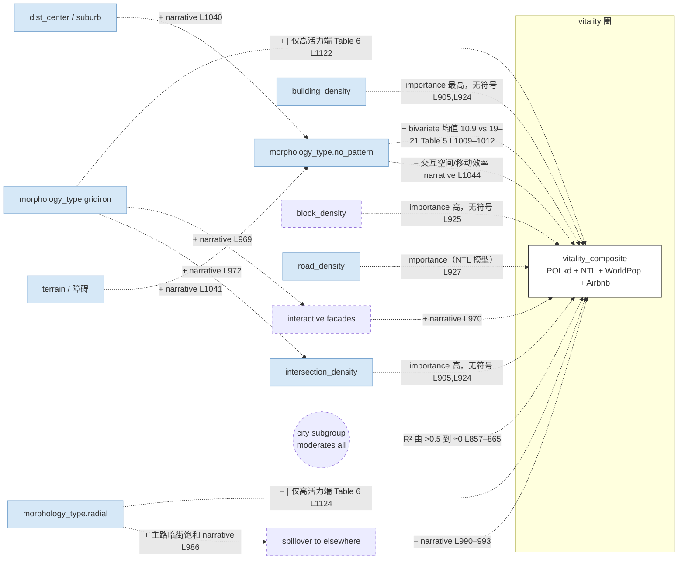

# Chen, Wu & Biljecki 2021 (9 城) — per-paper CLD（模板 v2.1）

## 一段话

作者在新加坡、上海、北京、纽约、芝加哥、西雅图、伦敦、巴黎、柏林九个城市的约 1 km 网格上，把 OSM POI 核密度、VIIRS 夜光、WorldPop 人口、Airbnb 房源核密度四个指标（推文密度因 R² 太低被剔除）标准化求和再缩放为 0–100 的 vitality score，然后用 ResNet-34 把每格路网图分类成方格 / 有机 / 放射 / 无形态四种概率，与七个传统形态指标（路网密度、交叉口密度、建筑密度、平均建筑基底面积、街区密度、平均街区面积、土地利用熵）一起喂进 LightGBM 预测活力分。发现：LightGBM 只报特征被选来分裂的次数，没有符号；开发强度类指标（建筑密度、交叉口密度、街区密度）在几乎所有活力子指标上最重要，路网形态概率除"无形态"外都不重要；加入形态概率后 R² 从 0.596 升到 0.623；无形态网格的活力均值 10.9 明显低于三种有形态的 19–21；在 top-10 高活力网格里方格网活力最高（89.7）而放射网建筑密度最高却活力最低（57.3）。用 CLD 看：这篇没有任何带符号的边，能进图的只有类别均值差（无形态 → 低活力）和高活力端的形态对比，都是双变量层；作者对放射网的解释——主干道汇聚使活力资源"溢出到别处"——是一条空间竞争的平衡回路叙事；城市子群之间形态–活力 R² 差异很大，是"城市类型作为隐藏调节变量"的直接证据。

## EN entry

Chen, Wu & Biljecki (2021) build a 0–100 "vitality score" for ~1-km grids in nine cities (Singapore, Shanghai, Beijing, New York, Chicago, Seattle, London, Paris, Berlin) by standardizing and summing OSM POI kernel density, VIIRS night-time light, WorldPop population and Airbnb listing density (tweet density is dropped for near-zero R²). A ResNet-34 classifier turns each grid's coloured road-hierarchy diagram into probabilities of gridiron, organic, radial and no-pattern form; these join seven conventional morphological indices (road, intersection, building and block density, mean footprint and block area, land-use entropy) as LightGBM features. LightGBM reports only split-count importance, no signs: development-intensity indices (building, intersection, block density) dominate every vitality component; road-pattern probabilities matter only through "no pattern"; augmentation lifts R² from 0.596 to 0.623. Direction is recoverable only from group means—no-pattern grids average 10.9 versus 19–21 for patterned ones—and from the top-10 most vital grids, where gridirons reach 89.7 while radials, despite the highest building density, stay at 57.3. For CLD purposes the paper contributes no signed edges; its useful content is a bivariate contrast, a spatial-competition narrative for radial networks (vitality resources "dispensed" elsewhere) and strong evidence that city subgroup moderates the morphology–vitality relationship.

## 0. 元数据

- Chen, W., Wu, A. N., & Biljecki, F. (2021). Classification of urban morphology with deep learning: Application on urban vitality. *Computers, Environment and Urban Systems*, 90, 101706.
- txt：`literature/papers/Chen-et-al-2021-Classification-of-Urban-Morphology-with-Deep-Learning.txt`（1466 行）；页码按 txt 页脚数字推断，未对 PDF 核
- **method-class**：`nonlinear-ml`（按分派）；实际 = LightGBM 分裂次数重要性（**无符号**）+ 类别均值 / 高活力端对比（描述层）。没有 SHAP / PDP / 回归系数。§3a 无内容，方向只进 §3b
- 单元：约 1 km × 1 km 网格（"each city is latticed into approx. 1 km × 1 km grids. The grids are in accordance with the 1 km resolution grids from WorldPop" L345–347）；网格总数未报告；地域：9 城（多城，按 §4.1 分四个子群）；样本期：未明说（Airbnb / Twitter / VIIRS 月均，年份未报）
- review 表位置：表 A #9；异常旗标 T4 成分级 + T2 疑似
- batch-B 已核行号（L654–657、L802、L905–909、L924–929、L937–938、L960–963、L996–1002、L1071–1085）本次全部重新 grep

## 1. DV

> "Provided that each of those vitality indicators reflects only one characteristic of urban vitality (human — tweet density, population; environment — POI density, NTL, and Airbnb density), we define an indicator called 'vitality score' that evaluates the level of interactions (among humans and between human and environment) by integrating our five vitality aspects. Vitality score ranges from 0 to 100. It is calculated by three steps: (1) standardize the vitality indicators, (2) sum them up, and (3) rescale." (L652–659, p.~6)
> "The R-squared of tweet density turned out to be low. … We thus exclude tweet density in the calculation of the vitality score." (L800–802, p.~8)

节点：**`vitality_composite`**（stock = 四个成分等权标准化和：`POI_density`（核密度，供给）+ `NTL` + `pop_density`（WorldPop，静态人口）+ Airbnb 核密度（供给）；Table 2 L664–700）。成分里两个是供给量、一个是静态人口、一个是灯光，没有实时在场人口。作者自己把人口和推文归 "human"、POI / NTL / Airbnb 归 "environment"（L653–654）。

sample-range：0–100（定义域）；Table 5 给按路网类别的均值 / 中位数 / SD（见 §3b）；全样本均值未报。

## 2. 节点表

单元统一约 1 km 网格；地域按 9 城；sample-range 全文只在 Table 6 报了 top-10 高活力格的均值（不是全样本），记 `未报告`。

| 论文变量 | node | construct | indicator | data | perspective | role |
|---|---|---|---|---|---|---|
| Prob_R / Prob_O / Prob_G / Prob_N | `morphology_type`（`.radial` / `.organic` / `.gridiron` / `.no_pattern`） | 路网形态类型 | ResNet-34 softmax 概率，CRHD 半径 1 km（L447–452） | OSM + 自建分类器 | top-down | IV（增强特征） |
| Road density (RD) | `road_density` | 路网密度 | 道路总长 / 网格面积（Table 1 L524–525） | OSM | top-down | IV |
| Intersection density (InD) | `intersection_density` | 局部连通性 | 交叉口数 / 面积（L526–528） | OSM | top-down | IV |
| Building density (BuD) | `building_density` | 建筑覆盖 | 建筑基底总面积 / 面积（L529–531） | OSM / 市政开放数据 | top-down | IV |
| Average building footprint area (ABFA) | `building_footprint` **new-node** | 建筑体量（平面） | 平均基底面积（L532–533） | 同上 | top-down | IV |
| Block density (BlD) | `block_density` **new-node** | 街区粒度 | 街区总面积 / 面积（L534–535）— 定义与 ABA 互为倒数关系 | 同上 | top-down | IV |
| Average block area (ABA) | `block_size` **new-node** | 街区粒度 | 平均街区面积（L536） | 同上 | top-down | IV |
| Land use mixture (LUM) | `functional_mix`（indicator = `landuse_mix`） | 功能混合度 | 土地利用 Shannon 熵（L537–538, L636–648） | 土地利用图 | top-down | IV |
| vitality score | `vitality_composite` | 合成活力 | 见 §1 | 多源 | top-down（POI、NTL、Airbnb）+ registry（WorldPop） | DV |
| 五个成分（各自也作 DV 训练模型） | `POI_density` / `social_media` / `NTL` / `pop_density` / `POI_density.airbnb` | — | Table 2 | OSM / Twitter API / VIIRS DNB / WorldPop / Inside Airbnb | top-down | component（也各自作 DV） |

**perspective 说明**：全篇没有 eye-level、survey 或 transactional 变量；DV 的四个成分也全是 top-down / registry。`morphology_type` 是本篇特有的 construct，README §5 已有该行（"受 morphology_type 调节（Chen21）"），但本篇给的不是调节效应，是类别均值差和子群 R² 差异（见 §3b、§3d）。

**indicator ledger 注意**：`POI_density` 在这里是 DV 的成分（核密度），不是 IV；与 Li21 / Wu 把 POI 计数当 IV 的用法角色相反（review 表 T1 成分级）。`block_density` 与 `ABA` 定义上近似倒数，作者两个都放进 LightGBM。

共线性：未报告任何相关矩阵或 VIF；树模型不要求。

## 3. 边表

### 3a. 系数 / SHAP

**无**。LightGBM 只报分裂次数（"feature importance of a feature is calibrated by the number of times it is selected for splitting treenodes" L919–920），没有符号，没有 SHAP，没有 PDP。以下所有"方向"都不是偏效应。

### 3b. 重要性排序（无符号）+ 类别均值 / 高活力端对比（`corr` 层，双变量）

**(i) LightGBM 重要性**（Fig. 8，L919–929，p.~9；vitality score 的 Fig. 8(f) 只说"analogous findings"，数值图依赖）

| 子 DV 模型 | 最重要特征（文字列出） | 行 |
|---|---|---|
| POI density | building_density、intersection_density、block_density | L923–925 |
| Tweet density | R² ≈ 0，作者称重要性可能误导 | L925 |
| NTL | building_density、building_footprint (ABFA)、road_density | L925–927 |
| Population、Airbnb | morphology_type.no_pattern 最强；其次 building_density、block_density | L927–929 |
| vitality score | "analogous"：开发强度指标为主，形态概率除 no_pattern 外不重要 | L905–909（Fig. 8(f) 图依赖） |

> "In conclusion, indicators regarding the development intensity (e.g. building density and intersection density) play a vital role in nearly all aspects of vitality, whereas probabilities of road network categories except for no pattern are in the opposite. Development intensity is the key for urban vitality in a grid, while comparatively patterned road network categories seem to matter not much." (L905–909)

**(ii) 增强模型 vs 基线**（Table 4，L867–888）：R² 0.5957 → 0.6227，RMSE 6.21 → 6.01；"small but positive" (L933)。

**(iii) 类别均值**（Table 5，L995–1022，p.~10）— 方向证据 1

| morphology_type | vitality score 均值 | 中位数 | SD | 行 |
|---|---|---|---|---|
| gridiron | 20.69 | 17.80 | 11.05 | L1009, L1014, L1019 |
| organic | 19.46 | 17.38 | 9.80 | L1010, L1015, L1020 |
| radial | 19.10 | 16.58 | 9.89 | L1011, L1016, L1021 |
| no pattern | **10.86** | 9.91 | 5.12 | L1012, L1017, L1022 |

> "It underscores a clear gap of average vitality score between no pattern and the other categories. In contrast, the differences among the gridiron, organic, and radial grids are subtle." (L936–938)

→ 边 B1：`morphology_type.no_pattern → vitality_composite`，sign_total = **−**（bivariate，类别均值差 ≈ −9）。

**(iv) top-10 高活力格对比**（Table 6，L1070–1124，p.~11）— 方向证据 2（尾部）

| morphology_type | building_density % | road_density m/km² | intersection_density /km² | block_size m² | block_density /km² | footprint m² | vitality score | 行 |
|---|---|---|---|---|---|---|---|---|
| gridiron | 58 | 22,444.9 | 704.5 | 24,484 | 126.3 | 1816.3 | **89.65** | L1098, L1102, L1106, L1110, L1114, L1118, L1122 |
| organic | 50 | 19,801.5 | 675.6 | 8,701 | 460.2 | 759.1 | 77.68 | L1099, L1103, L1107, L1111, L1115, L1119, L1123 |
| radial | **68** | 22,212.4 | 584.8 | 40,982 | 44.4 | 980.3 | **57.27** | L1100, L1104, L1108, L1112, L1116, L1120, L1124 |

> "In high vitality context, the gridirons surpass the counterparts much further in vitality score compared to the global case in Table 5. It should be noted that the radials keep the greatest building density whereas only achieve the lowest vitality score. In contrast, the gridirons and the organics keep lower building density but manage to maintain higher level of urban vitality." (L959–964)

→ 边 B2：`morphology_type.gridiron → vitality_composite`，sign_conditional = **+**，condition = 高活力端（score 60–100，L1054–1056）；全局 ns（Table 5 差异"subtle"）。
→ 边 B3：`morphology_type.radial → vitality_composite`，sign_conditional = **−**，同条件。
→ 反直觉对比：radial 组 building_density 最高（68 %）而活力最低——在高活力端，`building_density → vitality` 的正向关系被形态类型打断，是 `morphology_type` 调节 `building_density` 边的证据（README §5 记的是调节 `intersection_density`，本篇 Table 6 里 intersection_density 与活力同序：704.5 > 675.6 > 584.8，两者都说得通）。

**(v) 分段比例**（Fig. 9(b)，L1027–1036、L1054–1060，图依赖）：0–60 分区间三种有形态类别比例同步上升，no_pattern 比例骤降；60–100 分区间 gridiron + organic 占绝大多数，radial 与 no_pattern 趋近零。作者承认高分段样本极少（"due to the very limited number of instances in these two ranges" L1056–1057）。

### 3c. 间接 / 路径

无。

### 3d. 交互 / 阈值 / 调节

**城市子群作为调节变量**（Fig. 7，L843–866，p.~8；数值图依赖，只有文字分级）：

| 子群 | 形态–活力 R² 水平（文字） | 行 |
|---|---|---|
| 全体 | POI density 高（>0.5）；NTL / population / Airbnb 中；tweet 低 | L847–850 |
| radial-organic-mixed（London, Paris, Berlin） | 几乎全部高 | L857–858 |
| gridiron-organic-mixed（New York, Beijing） | 全部低于全体，多数仍中 | L858–860 |
| organic-dominated（Singapore, Shanghai） | 只有 population 中，其余无 | L861–862 |
| gridiron-dominated（Chicago, Seattle） | population 高，NTL 中，POI density 低 | L862–865 |

> "The difference among subgroups is substantial. It unveils that cities in different subgroups (with different combination of patterned road network categories) are likely to possess different morphology-vitality relationship." (L865–867, L900–901)

这是 README §3 冲突处理里"地域 = 隐藏调节变量"的直接证据：同一组 BE 指标在不同城市类型下解释力从 >0.5 到 ≈0。但作者只给了 R²，没给各子群内的方向。

**阈值雏形**：vitality score ≈ 60 是形态概率开始起作用的分界（"the probabilities of the patterned categories start to affect vitality evaluation in a way when vitality score is very high" L953–955）。这是 DV 侧的分段，不是 IV 阈值。

### 3e. 层级

无。

### 3f. Discussion 叙事（`narrative`）与方向解释

本篇没有负号系数；需要解释的是 no_pattern 低、radial 在高端低、以及 radial 建筑密度高却活力低。

| # | 链 | 方向判断 | 原句 | 行 |
|---|---|---|---|---|
| N1 | no_pattern 的成因：郊区、稀疏路网用地、地形障碍 → 人与活动都少；缺乏结构化路网 → 交互空间少、移动效率低 → vitality ↓ | IV→DV，但前半段说 no_pattern 本身是"郊区 / 障碍"的结果（`dist_center` / `terrain` → morphology） | "Subjective reasons could include locality in suburb, lying on land use requiring sparse network, etc. Objective reasons could be encountering geographic obstacle such as hills, lakes and parks. The area fitting the above description is relatively short of both human and activities. Also, the lack of well-structured networks causes less space for interaction and lower efficiency in all kinds of movements. All these result in lower level of vitality in no pattern area." | L1040–1046 |
| N2 | gridiron → 建筑四面临街 → 更多可交互立面；路网密而正交 → 交叉口多 → 行人移动高效 → 更多活动 | IV→DV（经 `intersection_density`、临街面） | "In gridiron road networks, most buildings are surrounded by four orthogonal roads, so every facade of the buildings gets the opportunity to be interactive. Besides, the intensive and orthogonal road network bring about more intersections, as is shown in Table 6. The increasing number of intersections is beneficial to the efficient movement of pedestrians and pave the way to incubate more human activities." | L969–974 |
| N3 | organic → 弯曲主干道扩大临街面，但路网密度更低 → "更经济" | IV→DV | "Organic networks also expand the facades for interactions by increasing the length of the roads via curvature. It provides less efficient space for interactions than the gridirons, but requires less road density as well (Table 6)." | L978–980 |
| N4 | **radial → 主干道汇聚中心 → 主路临街面交互多、其他区域活力被抑制 → 临街面饱和后活力资源（人、POI）溢出到别处 → 活力被分散** | IV→DV，且含 **B 回路**：中心饱和 → 溢出 → 本格活力不再上升 | "The movement between blocks would more or less resort to the major network, which breeds more interactions on the facades facing major roads but in turn discourages the vibrancy of other areas. If the interactive facades of one radial structure are fully occupied, the spillover vitality resources (people, POIs, etc.) would prefer to mitigate to a better position elsewhere because of the comparative advantage. As a result, the vitality resources would be dispensed and results in the difficulty in achieving high level of vitality." | L986–993 |
| N5 | 开发强度是全局主因 | — | "globally, development intensity is predominant in determining urban vitality, and the identification of no pattern is the primary source of the effect of road network classification on urban vitality evaluation." | L1048–1051 |
| N6 | 作者自己给高端结论降级 | — | "Gridiron and organic seems more suitable for achieving high-level of urban vitality than radial. However, this result has not been fully proven in this study." | L1158–1160 |

### 3g. Limitations（`limitation`，§5.3 L1060、L1167–1198，p.~11）

只谈方法：标注样本需扩充（L1168–1170）、分类器只识别整体形态（L1170–1177）、需要更多城市（L1178–1189）、活力预测案例"may not have been perfect to confirm the effectiveness"（L1190–1192）。**没有反向因果、双向或自选择**。

### 3h. DV→DV

vitality score 的成分之间：Table 3（L759–799）给了每个成分单独作 DV 时形态指标的 R²（城内标准化后：POI density 0.517、tweet 0.020、NTL 0.397、population 0.439、Airbnb 0.285，L791–799）。这是"形态 → 各成分"的解释力，不是成分间的边；成分间相关未报告。

## 4. Mermaid

没有带符号的系数边；只画 §3b 的双变量对比（虚）、§3f 的叙事（虚）与子群调节。

## 5. 回路

| loop-id | segments | closed-in-paper | dominance-regime |
|---|---|---|---|
| B-溢出（radial，半条） | `vitality_composite ↑ → 主路临街面饱和 → 活力资源（人、POI）迁往比较优势更高的别处 → 本格 vitality 停止增长`（narrative L986–993） | 否：全部叙事，只在 radial 形态下 | 作者限定在高活力端（score 60–100）且 radial；这是空间竞争型 B 回路，与 Li21 的 B-承载力同类，但这里承载力是"临街面"而非街道容量 |
| R-方格（半条） | `gridiron → intersection_density ↑ → 行人移动效率 → 活动 → vitality`（narrative L969–974） | 否：叙事链，无系数 | 高活力端 |

**论文内无实证回路**：LightGBM 单向预测；limitations 未提反向因果。

**morphology_type 作为调节变量**：README §5 记 "intersection_density 受 morphology_type 调节（Chen21）"。本篇的实际证据是 Table 6：radial 的 building_density 最高（68 %）而活力最低（57.3），gridiron 的 building_density 较低（58 %）而活力最高（89.7）——即在高活力端 `building_density → vitality` 的正向关系被形态类型打断；intersection_density 则与活力同序（704.5 > 675.6 > 584.8）。所以更准确的写法是 **morphology_type 调节 `building_density → vitality`**，而 intersection_density 是 gridiron 起作用的中介（N2）。建议整合时改词表那一行。

**城市子群作为隐藏调节变量**：Fig. 7 的 R² 差异（§3d）是语料里最直接的"同一组 BE 指标在不同城市类型下解释力不同"的证据，但没有方向信息，只能在整合层作为"跨论文符号冲突先查地域"的依据。

## 6. 提取备注

- **无任何带符号的边**：分派为 nonlinear-ml，但 LightGBM 只报分裂次数。本篇实质介于 `descriptive` 与 `nonlinear-ml` 之间；按任务指示方向只进 §3b（bivariate），§3a 留空。整合时本篇对任何 `X → vitality` 边都只能提供"重要性高"这一条弱证据，不能给 sign_total。
- **图依赖边：Fig. 8（a–f）重要性数值、Fig. 7 各子群 R² 数值、Fig. 9(b) 分段比例，需人工看图**。txt 只有文字描述的排序前三名（L923–929）和 R² 分级（L857–865）。
- **DV 是供给 + 静态人口 + 灯光的合成**，没有实时在场人口；`POI_density` 在这里是 DV 成分（T1 成分级）。整合时 `building_density → vitality_composite` 的"重要性高"有一部分是 `building_density → POI kernel density` 的构造性关系（建筑多的地方 OSM POI 多）。
- **Table 3 标准化策略**：城内标准化前 R² 全部 ≤ 0.13 甚至为负（L781–789），城内标准化后 POI、NTL、人口、Airbnb 升到 0.29–0.52，推文仍是 0.02（L791–799；*2026-10-02 更正，原文：「城内标准化后升到 0.29–0.52」，漏了推文一项*）——即跨城合并时城市固定效应吃掉了大部分方差。这本身就是"地域是调节变量"的证据，与 §3d 一致。
- **词表缺行**：`block_density`、`block_size`（ABA）、`building_footprint`（ABFA）三个街区 / 建筑粒度指标；`morphology_type` 需要四个子键。README §5 里 `morphology_type` 调节的对象建议从 `intersection_density` 改为 `building_density`（见 §5）。
- **Table 5 / 6 可对位**：txt 按列拆行但每列 4 或 3 项，计数吻合，已填入 §3b。Table 6 的 ABFA 列只有 3 个值中的后两个对应（1816.3 / 759.10 / 980.27），按序对齐。
- **模板问题**：`nonlinear-ml` 类假定有 SHAP 符号；只有重要性的论文需要一个"importance-only"标记，否则 §3a 空、§3b 又要塞类别均值对比，字段语义不对（类别均值差既不是 corr 也不是 coef）。建议 evidence 加 `group-mean` 取值。
