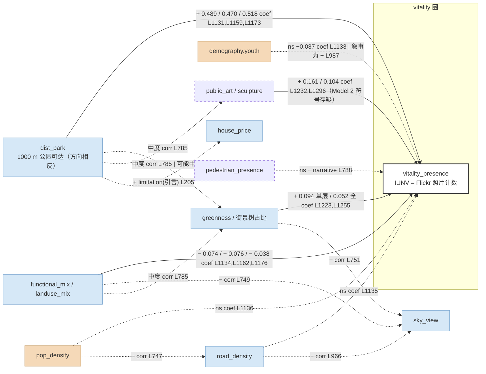

# Chen et al. 2024 (San Francisco, IUNV) — per-paper CLD（模板 v2.1）

## 一段话

作者把 2013–2022 年旧金山公园及其他城市自然空间里的 Flickr 地理照片数（清洗后 3434 张，按 block 汇总）叫做"隐含城市自然活力 IUNV"，用 6 个宏观变量（1000 m 公园可达覆盖、17 岁以下与 60 岁以上人口、土地利用熵、路网密度、人口密度）和 15 个街景语义分割要素（树、天空、人、雕塑、墙、围栏、座椅等）做三层 OLS，再补一个空间误差模型。发现：公园可达是唯一强因子（0.489，全模型 0.518），土地利用熵为负（−0.074，作者说人们更愿去交通方便、用途"纯"的自然空间），街景里只有树（0.094，加宏观变量后降到 0.052 且勉强显著）和雕塑（0.161）显著为正；街景整体只把 R² 从 0.434 抬到 0.490；Moran's I ≈ 0，空间误差模型与 OLS 结论一致。用 CLD 看：这篇的 DV 不是城市活力而是"自然空间被拍照的频次"，方法是三层回归而不是结构方程（论文里的 SEM 是 spatial error model，不是 structural equation model），所以没有直接/间接效应可拆；能拿到的是一组偏效应加相关矩阵里的几句话（树多则天空少、混合用途和密路网的街区天空少、树和雕塑与可达和熵中度相关），后者暗示"可达 / 熵 → 街景要素 → IUNV"的中介链但作者没建模；负号解释全是 IV→DV 方向；引言里承认过一次反向因果（公园可达抬高房价），是唯一的回路半段。

## EN entry

Chen et al. (2024) define "Implied Urban Nature Vitality" (IUNV) for San Francisco as the count of geotagged Flickr photos of parks and other urban natural spaces (2013–2022, 3,434 after cleaning), aggregated to block units. Six macro variables (park accessibility within 1,000 m, under-17 and over-60 population, land-use entropy, road density, population density) and fifteen street-view segmentation shares (tree, sky, person, sculpture, wall, fence, chair, …) enter three nested OLS models and a spatial error model. Accessibility is the only strong predictor (0.489; 0.518 in the spatial model); land-use entropy is negative (−0.074), which the authors read as visitors preferring accessible spaces with relatively pure land use; among street-view features only trees (0.094, dropping to 0.052 once macro variables enter) and sculptures (0.161) are significant. Street-view features raise R² only from 0.434 to 0.490; Moran's I ≈ 0. For CLD purposes the paper contributes partial effects and a few verbal correlations—trees reduce visible sky, mixed land use and dense roads reduce sky, trees and sculptures correlate moderately with accessibility and entropy—that hint at an unmodelled "macro → street-view → IUNV" mediation. All negative signs are explained IV→DV; the only reverse-causal statement (park access raises property values) appears in the introduction. The paper's "SEM" is a spatial error model, not a structural equation model.

## 0. 元数据

- Chen, M., Cai, Y., Guo, S., Sun, R., Song, Y., & Shen, X. (2024). Evaluating implied urban nature vitality in San Francisco: An interdisciplinary approach combining census data, street view images, and social media analysis. *Urban Forestry & Urban Greening*, 95, 128289.
- txt：`literature/papers/Chen-et-al-2024-Evaluating-Implied-Urban-Nature-Vitality.txt`（1698 行）；页码按 txt 页脚数字推断，未对 PDF 核
- **method-class**：`regression`（三层 OLS + 空间误差模型；**不是 sem-path**——分派时按 "SEM" 字样归为 sem-path，但原文 "A spatial error model (SEM) with full variables was built" L691，无潜变量、无间接效应）
- 单元：census tract（人口变量，"we utilize the remaining 240 spatial units" L259；Table 1 标 N=241）与 block group（公园可达按 "each block group center" L508；Flickr 照片 "based on the blocks unit" L558）——两种单元在文中混用，回归的 N 未明说。**2026-10-04 补（我们的推算，非作者所写）**：Table 4 的 Moran's I 期望值 −0.004184（L1343）= −1/(N−1) 时 N = 240（python 算 −1/239 = −0.0041841），与 240 个 census tract 吻合，所以空间检验、很可能连回归，都是在 240 个 tract 上做的
- 地域：旧金山（121.4 km²，L261）；样本期：ACS 2016–2020（census），Flickr 2013–2022（L549–550），GSV 26,810 点（L320）
- review 表位置：表 A #17；异常旗标 T2（IUNV = 街景物理绿量供给 + Flickr 人的活动）
- batch-C 已核行号（L983–988、L778–792、L1013–1016）本次全部重新 grep；batch-C 判 Table 3 "不可对位"，本次按 6 宏观 + 15 街景的固定计数对齐后可以对位（见 §3a），但未对 PDF 核

## 1. DV

> "Hence, we collected data from Flickr, subjected it to spatial analysis in ArcGIS Pro 3.0, and drew conclusions based on the quantity of photographs associated with different parks." (L544–547, p.~6)
> "Initially, we developed a custom Python script designed to crawl Flickr and download images of parks, with the specified timeframe set from 2013 to 2022. Our systematic data collection approach yielded a comprehensive dataset of 4180 images, each implicitly representing a public interaction with the urban nature depicted." (L548–552)
> "We employed the Google Vision API to process a total of 3434 social media images scraped from Flickr after cleaning." (L576–577, p.~6)
> "After the image categorization process, we created a spatially explicit dataset that depicted the distribution of Flickr images based on the blocks unit using ArcGIS Pro 3.0 (Fig. 4b)." (L556–558)

节点：**`vitality_presence`**（stock = 单元内自然空间的 Flickr 地理照片计数，即 `social_media` 作 DV；是到访痕迹，不是设备数；十年累计、偏向游客与年轻用户，L1385–1388）。12 个主题聚类（Table 2，L798–900）只用于定性解读，不进回归。下文边表的 `IUNV` 均指此子节点。

sample-range：未报告（Table 1 只给 census 变量；IUNV 的 min/max/mean 全文无）。

## 2. 节点表

单元见 §0；地域旧金山；不重复。census 变量 sample-range 来自 Table 1（L335–430，txt 拆行但可对齐）；街景与宏观 BE 变量的描述统计全文未报告。

| 论文变量 | node | construct | indicator | data | unit-scale | sample-range (min/max/mean) | perspective | role |
|---|---|---|---|---|---|---|---|---|
| Accessibility | `dist_park`（indicator = 1000 m 服务覆盖，方向与距离相反） | 到绿地距离 / 公园可达 | OSM 'leisure park' 442 个，block group 质心 1000 m 服务范围（L506–509） | OSM | block group，1000 m | 未报告 | top-down | IV（宏观） |
| Landuse entropy | `functional_mix`（indicator = `landuse_mix`） | 功能混合度 | 土地利用 Shannon 熵，0–1（L516–531） | OSM land use | block | 未报告 | top-down | IV（宏观） |
| Road density | `road_density` | 路网密度 | 道路总长 / block 面积（L568–570） | OSM | block | 未报告 | top-down | IV（宏观） |
| Pop density | `pop_density` | 静态人口 | ACS 人口估计（Table 1 "Population" 3816 mean；是否除以面积原文未说） | ACS 2016–2020 via CDC SVI | census tract | 0 / 7518 / 3816.3（L354–357） | registry | IV（宏观） |
| Age<17 | `demography.youth` | 年龄结构 | 17 岁以下人口数 | 同上 | tract | 0 / 1450 / 490.8（L412–415） | registry | IV（宏观） |
| Age>60 | `demography.elderly` | 年龄结构 | 65 岁以上人口数（Table 1 用 65+，Table 3 标 Age>60） | 同上 | tract | 0 / 1808 / 629.8（L370–373） | registry | IV（宏观） |
| Tree | `greenness`（**街景绿视率**） | 绿量 | ADE20K 分割树占比，街道均值（L325–345） | GSV 26,810 张 | street → block | 未报告 | eye-level | IV（微观） |
| Grass | `greenness`（变体：草地占比） | 绿量 | 同上 | 同上 | 同上 | 未报告 | eye-level | IV |
| Sky | `sky_view` | 街道开敞度 | 天空占比 | 同上 | 同上 | 未报告 | eye-level | IV |
| Person | `pedestrian_presence` **new-node** | 街景中在场行人 | 人像素占比 | 同上 | 同上 | 未报告 | eye-level | IV（本质是 vitality_presence 的另一 proxy，见 §6） |
| Sculpture | `public_art` **new-node** | 公共艺术 / 地标物 | 雕塑占比 | 同上 | 同上 | 未报告 | eye-level | IV |
| Wall / Fence | `enclosure` **new-node** | 围合 / 隔断 | 墙、围栏占比 | 同上 | 同上 | 未报告 | eye-level | IV |
| Chair | `street_furniture` **new-node** | 街道家具 | 座椅占比 | 同上 | 同上 | 未报告 | eye-level | IV |
| Sidewalk | `sidewalk` | 人行道 | 人行道占比 | 同上 | 同上 | 未报告 | eye-level | IV |
| Street light | `lighting` | 照明 | 路灯占比 | 同上 | 同上 | 未报告 | eye-level | IV |
| Water / Fountain / Mountain / Bridge / Earth | `scenery` **new-node** | 景观要素 | 各自像素占比 | 同上 | 同上 | 未报告 | eye-level | IV |
| IUNV | `vitality_presence` | 到访痕迹 | Flickr 照片计数 | Flickr 2013–2022 | block | 未报告 | transactional（UGC） | DV |

控制变量：无单独控制项；贫困、教育、族裔（Table 1 列出）**未进 Table 3**，只在 §3.1 的 GIS 叠加图（Fig. 7）里定性讨论。

**perspective 说明**：本文是 batch 里 eye-level 变量最多的一篇（15 个街景要素），但它们全部是像素占比，没有感知模型打分（作者自己在 limitations 说未考虑 perception，L1413–1415）。`greenness` 在这里是绿视率（eye-level），与 Mouratidis 的卫星绿地占比、以及本文自己的 `dist_park`（top-down 公园可达）是三个不同 indicator——本文同时含 top-down 公园可达（+）和 eye-level 树（+），两者同向，不构成 README §5 说的"大面积公园 vs 街道绿化反号"。

## 3. 边表

### 3a. 回归系数（`coef`，Table 3，L1054–1325，p.~10）

**2026-10-04 已对 PDF 核**（附件 PDF 第 11 页文本层，按行排列）：21 行系数与 p 值与下表逐一吻合，txt 对位无误。旧文本："计数完全吻合，按序对齐；**未对 PDF 核**"。

txt 把 Table 3 按列堆叠：Model 0 宏观 6 系数 L1131–1136、p 值 L1138–1143；Model 1 街景 15 系数 L1219–1233、p 值 L1235–1249；Model 2 宏观 L1159–1164 / p L1166–1171、街景 L1251–1265 / p L1267–1281；空间误差模型宏观 L1173–1178 / p L1180–1185、街景 L1283–1297 / p L1299–1313。变量顺序按 L1092–1113 表头（Accessibility, Age>60, Age<17, Landuse entropy, Road density, Pop density; Sidewalk, Person, Street light, Grass, Tree, Chair, Sky, Water, Fence, Wall, Earth, Fountain, Mountain, Sculpture, Bridge）。计数完全吻合，按序对齐；**未对 PDF 核**。R²：Model 0 0.434（L1317；2026-10-04 改，旧文本 "L1142"）、Model 1 0.121（L1321）、Model 2 0.490（L1325）。

| # | source | target | Model 0 / 1（单层） | Model 2（全） | 空间误差（全） | sign_direct | 行 | 备注 |
|---|---|---|---|---|---|---|---|---|
| 1 | dist_park（accessibility） | IUNV | 0.4889 (<0.001) | 0.4700 (<0.001) | 0.518 (<2.2e-16) | **+**（可达 +，即距离 −） | L1131, L1159, L1173 | 最强因子 |
| 2 | demography.elderly (Age>60) | IUNV | 0.0050 (0.802) | 0.0022 (0.915) | −0.003 (0.849) | ns | L1132, L1160, L1174 | |
| 3 | demography.youth (Age<17) | IUNV | −0.0366 (0.062) | −0.0332 (0.112) | −0.022 (0.166) | ns（边缘） | L1133, L1161, L1175 | **符号与叙事矛盾**：作者说青少年多则 IUNV 高（L987–988），表里系数为负。2026-10-04 对 PDF p.11 行 "Age<17 -0.0366 0.062 / / -0.0332 0.112 -0.022 0.166"：负号在原表里，不是 txt 对位问题（旧文本："可能是列对齐或原表问题"） |
| 4 | functional_mix（landuse entropy） | IUNV | −0.0735 (0.013) | −0.0759 (0.015) | −0.038 (0.080) | **−** | L1134, L1162, L1176 | 唯一显著负号 |
| 5 | road_density | IUNV | −0.0311 (0.434) | −0.0195 (0.640) | −0.013 (0.698) | ns | L1135, L1163, L1177 | 摘要称 dominant，表里不显著 |
| 6 | pop_density | IUNV | 0.0199 (0.556) | 0.001 (0.998) | −0.004 (0.885) | ns | L1136, L1164, L1178 | |
| 7 | sidewalk | IUNV | −0.0131 (0.567) | 0.0027 | −0.006 | ns | L1219, L1251, L1283 | |
| 8 | pedestrian_presence (person) | IUNV | −0.0092 (0.828) | −0.0162 | −0.002 | ns（三模型皆负但不显著） | L1220, L1252, L1284 | 作者叙述为"负相关"（L788） |
| 9 | lighting (street light) | IUNV | −0.0499 (0.305) | −0.0007 | 0.018 | ns | L1221, L1253, L1285 | |
| 10 | greenness (grass) | IUNV | 0.0401 (0.327) | −0.0173 | 0.004 | ns | L1222, L1254, L1286 | |
| 11 | greenness (tree) | IUNV | **0.0942 (0.004)** | 0.0515 (0.053) | 0.042 (0.052) | + | L1223, L1255, L1287 | 加宏观变量后系数减半、显著性降到边缘 |
| 12 | street_furniture (chair) | IUNV | 0.0242 (0.697) | 0.0278 | 0.029 | ns | L1224, L1256, L1288 | 作者叙述为"正相关"（L791） |
| 13 | sky_view | IUNV | 0.0335 (0.364) | −0.0150 | −0.014 | ns | L1225, L1257, L1289 | |
| 14 | scenery (water) | IUNV | 0.0150 | 0.0045 | 0.011 | ns | L1226, L1258, L1290 | |
| 15 | enclosure (fence) | IUNV | −0.0206 (0.542) | −0.0224 | −0.011 | ns | L1227, L1259, L1291 | 作者叙述为"负"（L790） |
| 16 | enclosure (wall) | IUNV | −0.0283 (0.644) | −0.0139 | −0.023 | ns | L1228, L1260, L1292 | |
| 17 | scenery (earth) | IUNV | 0.0109 | −0.0077 | −0.019 | ns | L1229, L1261, L1293 | |
| 18 | scenery (fountain) | IUNV | −0.0700 (0.158) | −0.0519 | −0.053 (0.117) | ns | L1230, L1262, L1294 | |
| 19 | scenery (mountain) | IUNV | −0.0133 | −0.0225 | −0.018 | ns | L1231, L1263, L1295 | |
| 20 | public_art (sculpture) | IUNV | **0.1613 (<0.001)** | **−0.1169 (<0.001)** | **0.104 (<0.001)** | + | L1232, L1264, L1296 | Model 2 列的负号与 Model 1、空间模型及叙事（L784–785）相反。2026-10-04 对 PDF p.11 行 "Sculpture / / 0.1613 <0.001** -0.1169 <0.001** 0.104 <0.001**"：负号在发表的表里，txt 忠实；是原文自相矛盾，无法判断哪列对（旧文本："疑为 txt/原表符号错误，记 `未提取（txt 符号存疑）`"） |
| 21 | scenery (bridge) | IUNV | 0.0104 | 0.0138 | −0.015 | ns | L1233, L1265, L1297 | |

> "Among these macro-level factors, accessibility demonstrated the most significant positive association with IUNV, followed by land use entropy, which exhibited a negative relationship." (L983–985, p.~9)
> "The presence of sculptures and trees were the two most powerful street view features affecting IUNV." (L778–779)

### 3b. 相关矩阵与共线性（`corr`，Fig. 7 热图，L745–753、L963–970，p.~8–9）

Fig. 7 的数值 txt 里没有；只有文字描述的几对：

| # | 对 | 符号 | 原句 | 行 |
|---|---|---|---|---|
| C1 | pop_density – road_density | + | "At the macro level, population density and road density were found to have a positive association." | L747–748 |
| C2 | functional_mix – sky_view | − | "Similarly, land use entropy and sky coverage also demonstrated a comparable negative correlation." | L749–751 |
| C3 | greenness(tree) – sky_view | − | "Among street view variables, an increase in the ratio of trees corresponds to a decrease in the proportion of visible sky." | L751–752 |
| C4 | greenness(tree) / public_art – dist_park(accessibility) / functional_mix | 中度 | "Both trees and sculptures showed a moderate correlation with accessibility and land use entropy, suggesting these macro-level variables may partly explain their observed impact on IUNV." | L785–787 |
| C5 | demography.youth / elderly – sky_view | + | "Blocks with a higher density of individuals under 17 and elderly populations appear to have greater sky exposure." | L965–966 |
| C6 | functional_mix / road_density – sky_view | − | "Blocks with highly mixed land use and dense road connectivity tend to have less sky view." | L966–967 |

共线性：作者判断无多重共线性，**未剔除任何变量**（"all variables do not have extremely high Pearson correlation with others, it is presumable that there is no multicollinearity issue" L968–969）。无 VIF。

双变量 vs 偏回归对照：tree 在 Model 1 单独显著（0.094, p=0.004），加入宏观层后降到 0.052（p=0.053）——与 C4 一致，tree 的一部分效应被 accessibility / entropy 吸收，暗示 `dist_park → greenness(tree) → IUNV` 或共同原因，作者未建模。

### 3c. 间接 / 路径

**无**。方法是三层 OLS 嵌套比较，不是结构方程；空间误差模型只处理残差空间相关（"The MSE model's findings were similar to those of the OLS models, suggesting no significant improvement in interpretability" L794–796；Moran's I −0.01355，L793）。

### 3d. 交互 / 阈值

无。

### 3e. 层级

无。

### 3f. Discussion 叙事（`narrative`）与负号解释

| # | 边 / 链 | 方向判断 | 原句 | 行 |
|---|---|---|---|---|
| N1 | functional_mix → IUNV −：人们更愿去交通方便、用途"纯"的地方 | IV→DV | "These results demonstrate that people in our study site were likelier to go places with convenient transport and relatively pure land uses." | L985–987 |
| N2 | functional_mix → IUNV −：不同类型自然空间对用途混合反应不同（引 Suzhou 案例） | IV→DV，但实际是异质性解释（不同 UGS 类型应分开） | "this conflict can be explained by the mixture of land uses in this project because different types of urban natural space have different reactions to land uses (Ma et al., 2023)." | L1013–1016 |
| N3 | pedestrian_presence → IUNV −：拥挤降低感知活力 | IV→DV | "The presence of people negatively correlated with IUNV across all models, indicating that crowded environments might detract from the perceived vitality." | L788–790 |
| N4 | enclosure → IUNV −；street_furniture → IUNV + | IV→DV | "Walls and fences negatively influenced activity willingness, while chairs had a positive correlation, highlighting the importance of open, recreational spaces for enhancing vitality." | L790–792 |
| N5 | dist_park（可达）→ IUNV + | IV→DV | "Urban green space located in places with easier accessibility appears to have higher vitality." | L1008–1009 |
| N6 | demography.youth → IUNV +：年轻人用社交媒体 | IV→DV，且承认是测量偏差机制 | "Conversely, younger populations in areas like South Beach and Mission Bay exhibited higher IUNV, likely due to their engagement with mobile technology and social media." | L733–735 |
| N7 | 宏观 → 街景 → IUNV（中介暗示） | IV→M→DV | C4 原句（L785–787） | L785–787 |
| N8 | 街景层只弱增 R²；宏观层主导 | — | "However, the influencing magnitude was relatively weak, showing macro-level factors were still the main component dominating the IUNV." | L1035–1037 |

**负号清单**：(a) functional_mix −0.074（显著）：N1、N2，IV→DV；(b) person、wall、fence（不显著）：N3、N4，IV→DV；(c) Age<17 表里为负但作者按正叙述（N6）——作者没解释负号，因为作者没把它当负号。

### 3g. Limitations（`limitation`，L1377–1420，p.~11–12）

| # | 内容 | 类型 | 原句 | 行 |
|---|---|---|---|---|
| L1 | 单城、样本小 | 外推 | "Firstly, the sample size is relatively small, focusing only on San Francisco" | L1379–1380 |
| L2 | 社交媒体偏向年轻人 → DV 测量偏差（与 N6 呼应：Age<17 的"效应"部分是 DV 的采样偏差） | 测量 | "Thus, the perception and interaction with UGS might be skewed towards a younger demographic." | L1387–1388 |
| L3 | 聚类不精确 | 方法 | L1391–1395 | |
| L4 | 无时序 | 横截面 | "this study did not account for the temporal changes in the data" | L1394–1395 |
| L5 | 未考虑感知 | 遗漏变量 | "our study focused primarily on the physical built environment and vitality without considering perception" | L1413–1415 |
| L6（引言） | **反向因果**：公园可达抬高房价，使可达高的区域更富裕 | DV 侧变量 → 社经属性 | "The direction of the causality in this relationship may even be inverted, with access to UGS having been suggested to raise real estate values, rendering areas with stronger access more well-off than areas with less such development (Chen et al., 2022)." | L204–208 |

Limitations 本身**没有承认反向因果或自选择**；L6 出现在引言文献回顾里，且说的是 `dist_park → house_price`，不是 IUNV 的反向。

### 3h. DV→DV

无（单一 DV）。12 个 IUNV 主题聚类（Table 2）不是维度，是照片内容分类。

## 4. Mermaid

只画显著边（实）与文字相关（虚）；不显著的 15 个街景要素不画。

## 5. 回路

| loop-id | segments | closed-in-paper | dominance-regime |
|---|---|---|---|
| R-绿地资本化（半条） | `dist_park（可达）→ house_price ↑`（L6，引言引文献）；`house_price → 谁住这里（demography / 富裕程度）`（引言：rendering areas with stronger access more well-off）| 否：只有上游两段，没连回 IUNV；且是文献陈述不是本文发现 | — |
| 中介链（非回路） | `dist_park / functional_mix → greenness(tree) / public_art → IUNV`（C4 + tree 系数在加入宏观层后减半） | 否（作者只说"may partly explain"，未做中介检验） | — |

**论文内无回路**：横截面 OLS；limitations 未提反向因果；DV 是十年累计照片数，本身就不含动态。

**唯一带方向的反向叙述**（L204–208）是绿地可达 → 房价 → 居民构成，对应 review 讨论 R2 居住集聚的绿地版本；这篇只把它当背景文献。

## 6. 提取备注

- **method-class 分派错误**：任务给的是 sem-path，原文的 "SEM" 是 spatial error model（L691）。按 `regression` 处理；§3c 无内容。建议提示词/分派表在标 sem-path 前 grep "structural equation" 确认。
- **2026-10-04 已对 PDF 核（p.11 文本层）**：两处异常都在发表的原表里，不是 txt 问题；同时发现作者自己的显著性星号与其阈值不一致——作者写 "We considered P-values of <0.005 and <0.050 highly significant and statistically significant"（L976–977），但表里 p=0.053（tree，Model 2）和 p=0.080（land use entropy，空间模型）也标了 \*。所以 "tree 加宏观后仍显著" 和 "entropy 在空间模型里仍显著" 都不成立。另：12 类聚类的最高轮廓系数只有 0.04615（L757–758），接近 0，说明照片标签几乎没有聚类结构，12 类主要靠人工命名（L766–769）。下面是旧文本，保留：
- **Table 3 可对位**：batch-C 记为"打散不可对位"，但 txt 按 [宏观 6 系数][6 p][街景 15 系数][15 p] 固定块堆叠（L1129–1313），计数完全吻合，本次按序对齐填入 §3a。仍需对 PDF 核两处异常：(1) Age<17 系数三模型皆负（−0.037 / −0.033 / −0.022）而正文说青少年多则 IUNV 高（L987–988）——如果 Age>60 与 Age<17 两行在 txt 里互换，则与叙事一致；(2) sculpture 在 Model 2 为 −0.1169（p<0.001）而 Model 1 为 +0.1613、空间模型 +0.104，且叙事说雕塑显著提高 IUNV（L784–785）——疑为符号排版错误。两处按规则记为存疑，不改数值。
- **DV 不是城市活力**：IUNV = 自然空间的 Flickr 照片数，作者自己在标题和正文里都叫 "urban nature vitality"。挂到 `vitality_presence` 是最接近的 stock（到访痕迹），但它十年累计、只覆盖公园与绿道、偏年轻用户（L1385–1388）。整合时与 Tan / Wu 的实时设备数比较要标 indicator 差异；建议 vitality 圈考虑加 `vitality_trace`（UGC 痕迹）子节点或在 ledger 里标 "累计 vs 实时"。
- **person（街景行人占比）是 IUNV 的另一个 proxy 被当作 IV**：与 Li21 的 crowd counting 同一问题（T5）；这里它不显著，且作者的"拥挤降低感知活力"解释（N3）把 eye-level 在场人数当成了负因子。新节点 `pedestrian_presence` 标为 vitality_presence 的 eye-level 代理，整合时不当上游。
- **单元不一致**：census 变量在 tract（240/241），可达与照片在 block group / "blocks unit"，回归 N 未报告。operating-range 全部 `未报告`（除 Table 1 census 计数）。
- **词表缺行**：`public_art`（雕塑）、`enclosure`（墙/围栏）、`street_furniture`（座椅）、`scenery`（水/山/桥/喷泉/地面）、`pedestrian_presence` 五个 eye-level 要素类词表没有；`demography` 需要 `.youth` / `.elderly` 子键。`dist_park` 行需要注明 indicator 可以是"可达覆盖"（方向相反），与 `transit_access` 的处理一致。
- **贫困 / 教育 / 族裔未进回归**：Table 1 列了 9 个 census 变量，Table 3 只用了人口与两个年龄段；教育与 IUNV 的关系只有一句 GIS 叠加的定性描述（"regions with lower high school diploma achievement correlate with IUNV" L730–731，方向都没写清）。不入边表。
- **模板问题**：`regression` 类论文有多层嵌套模型（单层 / 全 / 空间）时，§3a 一行要放三个系数；本篇用三列处理，README §3 只定义了单个 sign_direct，建议加 "model-spec" 列或允许多列。
