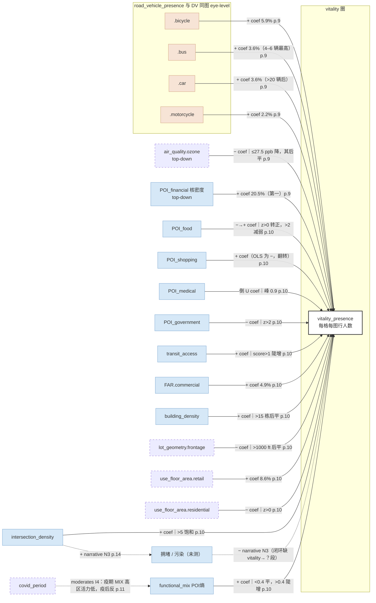

# Doan et al. 2025（曼哈顿，XGBoost + SHAP）— per-paper CLD（模板 v2.1）

## 一段话

作者把曼哈顿划成 5 679 个 100 m × 100 m 格子，用 YOLOv5 在 29 540 个点的 Google 街景图里数行人，把"每格平均每张图的行人数"当活力（因变量干净，是人的活动，不含供给成分）；再用 XGBoost + SHAP 看建成环境、道路车辆、臭氧对这个活力的非线性与阈值效应。结论：建成环境占模型归因的 77.5%，车辆 15.18%，臭氧 1.46%；金融服务核密度是第一因子（20.5%）；普遍存在阈值——臭氧负向作用到 27.5 ppb 后变平、POI 混合熵过 0.4 陡增、路口数过 5 饱和、医疗服务倒 U（峰 0.9）。用 CLD 看：这是"单向、不成环"最精致的样本——连 SHAP interaction 图（Fig. 12）给的也是因子 × 因子 → 活力的联合作用，不是因子之间的路径。两个对我们的专门价值：① 行人与车辆来自**同一批图像**，DV 和 IV 共享拍摄时刻的"场景曝光"，是 T5 的隐蔽形式；② OLS 与 SHAP 之间出现符号翻转（购物服务 OLS −1.39 但 SHAP 为正、商业面积 OLS −1.47 但 SHAP 为正），是"线性 baseline 有偏"的直接证据，正好喂给我们三步逻辑的第一、二步对照。

## EN entry

Doan, Ma, Chen and Zhang (2025) model urban vitality in Manhattan as the average number of pedestrians per street-view image in 5,679 grids of 100 m, detected by YOLOv5 in 82,180 Google Street View panoramas at 29,540 points (Feb 2021–Jan 2022). XGBoost (R² = 0.560) with SHAP is compared against OLS, GBDT and Random Forest. Built-environment variables account for 77.5 % of attributed variance, road vehicles (bicycle, car, bus, motorcycle counts from the same images) for 15.2 %, and ozone for 1.5 %; financial-services kernel density is the top single factor (20.5 %). Effects are nonlinear with thresholds read off SHAP dependence plots: ozone reduces vitality up to 27.5 ppb then flattens; POI entropy matters little below 0.4 and rises steeply above; intersection count saturates beyond 5; medical services follow an inverted U peaking at 0.9. The DV is a clean single activity indicator, but vehicle regressors come from the same images as the pedestrian DV, so "vehicles promote vitality" partly reflects shared scene exposure. Several OLS signs flip under XGBoost (shopping services, commercial area), evidence that linear baselines bias effect estimates. SHAP interactions (transit × facility FAR, financial × retail, COVID × POI mix) are joint effects on vitality, not factor-to-factor paths. The authors acknowledge that machine learning "do[es] not establish causation" and that street-view images miss temporal dynamics and indoor activity. For CLD purposes: a one-directional, loop-free map with rich threshold information; all thresholds are eyeballed and may partly be tree-model flat extrapolation beyond data support.

## 0. 元数据

- Doan, Q. C., Ma, J., Chen, S., & Zhang, X. (2025). Nonlinear and threshold effects of the built environment, road vehicles and air pollution on urban vitality. *Landscape and Urban Planning*, 253, 105204. https://doi.org/10.1016/j.landurbplan.2024.105204
- **txt：无**。论文不在 `literature/papers/`（该目录只读），只有会话附件 PDF。本文引用一律给 **PDF 页码**（p.X），不给行号——模板偏差，见 §6。
- **method-class**：`nonlinear`（XGBoost + SHAP；OLS 只用于变量筛选）
- 单元：100 m × 100 m 格，5 679 格（p.6）；SVI 每 30 m 一点、四方向拼接（p.4）
- 地域：曼哈顿（NYC）；样本期：街景 2021.2–2022.2（含 COVID 期，p.4）；MapPLUTO 2021；污染为 2021 年预测面（250 m）
- 不在 `vitality_indicators_review.md` 的表里（新读论文）。第一作者与通讯单位同 Doan-Zhang 2025 系统综述团队（HKU）

## 1. DV

> "Urban vitality was represented by pedestrian presence in 29,540 street-view images."（摘要，p.1）
> "Therefore, this study used pedestrian volume in street view images to represent urban vitality."（p.3）
> "The person class is aggregated by dividing the total number of detected individuals in all images of a square by the number of processed SVI within the same grid."（p.6）

单一指标，指向 `vitality_presence`（在场人数）。**DV 无供给成分，符合 §8 合并契约。**范围 0–102 人/图，均值 6.403，SD 8.310（Appendix 2，p.17）。

## 2. 节点表

| 论文变量 | node | construct | indicator | data | unit-scale | sample-range | perspective | role |
|---|---|---|---|---|---|---|---|---|
| 行人数 | `vitality_presence` | 在场人数 | YOLOv5 person，每格每图均值 | Google 街景 2021–22 | 100 m 格 | 0–102，均 6.4 | eye-level | DV |
| 自行车数 | `road_vehicle_presence.bicycle` **new-node** | 路上车辆在场 | YOLOv5 bicycle | 同上图（**与 DV 同图**） | 同上 | 0–9，均 0.17 | eye-level | IV |
| 汽车数 | `road_vehicle_presence.car` **new-node** | 同上 | YOLOv5 car | 同上 | 同上 | 0–221，均 45.9 | eye-level | IV |
| 公交数 | `road_vehicle_presence.bus` **new-node** | 同上 | YOLOv5 bus | 同上 | 同上 | 0–15，均 0.90 | eye-level | IV |
| 摩托数 | `road_vehicle_presence.motorcycle` **new-node** | 同上 | YOLOv5 motorcycle | 同上 | 同上 | 0–22，均 0.18 | eye-level | IV |
| 臭氧 | `air_quality.ozone`（沿用 Lee-Kang `air_quality.*`） | 空气污染 | 夏季平均 O₃ ppb | NYC Open Data 预测面 250 m | 格 | 23.0–32.5，均 28.1，SD 1.2 | top-down | IV |
| PM2.5 / NO₂ | `air_quality.PM2.5` 等 | 同上 | 年均 | 同上 | 格 | 未进终模（不显著） | top-down | 筛除 |
| POI 混合熵 | `functional_mix` | 功能混合度 | 11 类 POI Entropy index | Overpass Turbo（OSM） | 格 | 0–0.769，均 0.074 | top-down | IV |
| 金融服务密度 | `POI_density.POI_financial` **new-subtype** | 设施供给 | 核密度（z） | 同上 | 格 + 核带宽外溢 | z −0.87–4.58 | top-down | IV |
| 餐饮服务密度 | `POI_density.POI_food` | 同上 | 核密度（z） | 同上 | 同上 | z −0.90–4.40 | top-down | IV |
| 购物服务密度 | `POI_density.POI_shopping` | 同上 | 核密度（z） | 同上 | 同上 | z −1.59–3.63 | top-down | IV |
| 医疗服务密度 | `POI_density.POI_medical` **new-subtype** | 同上 | 核密度（z） | 同上 | 同上 | z −1.06–5.48 | top-down | IV |
| 科教服务密度 | `POI_density.POI_science` **new-subtype** | 同上 | 核密度（z） | 同上 | 同上 | z −0.77–6.57 | top-down | IV |
| 政府服务密度 | `POI_density.POI_government` **new-subtype** | 同上 | 核密度（z） | 同上 | 同上 | z −0.98–3.73 | top-down | IV |
| 生活服务密度 | `POI_density.POI_life_service` | 同上 | 核密度（z） | 同上 | 同上 | 未进 SHAP 前 23 | top-down | IV |
| 交通站点密度 | `transit_access` | 公交可达 | 轨道/地铁/公交/共享单车站核密度（z） | 同上 | 同上 | z −1.11–3.97 | top-down | IV |
| 商业容积率 | `FAR.commercial` | 开发强度 | CommFAR | MapPLUTO 2021 | 格 | 0–15，均 2.3 | registry | IV |
| 设施容积率 | `FAR.facility` | 同上 | FacilFAR | 同上 | 格 | 0–15，均 5.8 | registry | IV |
| 住宅容积率 | `FAR.residential` | 同上 | ResidFAR | 同上 | 格 | 0–10，均 4.5 | registry | IV（SHAP 次要） |
| 建筑栋数 | `building_density` | 建筑覆盖 | 栋数 | 同上 | 格 | 0–134，均 6.9 | registry | IV |
| 楼层数 | `building_height` | 体量 | 层数 | 同上 | 格 | 0–104，均 7.8 | registry | IV |
| 路口数 | `intersection_density` | 局部连通性 | 格内节点数 | 路网 | 格 | 0–20，均 0.83 | top-down | IV |
| 地块面宽 | `lot_geometry.frontage` **new-node** | 街区尺度 | 平均面宽（feet） | MapPLUTO | 格 | 0–8 744，均 377 | registry | IV |
| 地块进深 | `lot_geometry.depth` **new-node** | 同上 | 平均进深（feet） | 同上 | 格 | 0–5 000，均 312 | registry | IV |
| 零售面积 | `use_floor_area.retail` **new-node** | 分用途建筑面积 | 零售面积 ft²（z） | 同上 | 格 | z −0.21–9.21 | registry | IV |
| 商业面积 | `use_floor_area.commercial` **new-node** | 同上 | 商业面积 ft²（z） | 同上 | 格 | z −0.32–9.44 | registry | IV |
| 住宅面积 | `use_floor_area.residential` **new-node** | 同上 | 住宅面积 ft²（z） | 同上 | 格 | z −0.21–9.42 | registry | IV |
| 住宅单元数 | `housing_stock` **new-node** | 住宅存量 | 单元数 | 美国普查局 block | 格 | 未报告 | registry | control |
| 季节 | `season` **new-node** | 时序控制 | 四季 | — | 格 | — | — | control |
| COVID 期 | `covid_period` **new-node** | 时序控制 | 爆发期 0/1 | — | 格 | — | — | control / moderator |
| 人口密度 | `pop_density` | 静态人口 | WorldPop 200 m | WorldPop | 格 | 未进终模 | top-down | 筛除 |

## 3. 边表

### 3a. 系数（OLS 与 SHAP；SHAP 符号/贡献为 `coef`，目标均为 `vitality_presence`）

| # | source | OLS（Table 2, p.8） | SHAP 贡献 %/排名（Table 4, p.10） | SHAP 符号与形态 | 行（页） |
|---|---|---|---|---|---|
| 1 | road_vehicle_presence.bicycle | +1.5929*** | 5.864 / 4 | +，正向非线性（Fig. 5a） | p.7, p.9 |
| 2 | road_vehicle_presence.car | +0.0160***（"negligible effect"） | 3.560 / 11 | +，>20 辆后才显现 | p.7, p.9 |
| 3 | road_vehicle_presence.bus | +0.2582*** | 3.560 / 11 | +，4–6 辆时最高 | p.7, p.9 |
| 4 | road_vehicle_presence.motorcycle | +0.6616*** | 2.199 / 12 | + | p.7, p.9 |
| 5 | air_quality.ozone | −0.4105*** | 1.466 / 14 | −，到 27.5 ppb 后变平 | p.7, p.9 |
| 6 | POI_density.POI_financial | +2.1373*** | **20.524 / 1** | + | p.7, p.9 |
| 7 | use_floor_area.retail | +1.4660*** | 8.586 / 2 | + | p.7–8 |
| 8 | intersection_density | +0.7783*** | 6.492 / 3 | +，>5 后略降（饱和） | p.7, p.10 |
| 9 | functional_mix（POI 熵） | +5.7117*** | 4.607 / 7 | 0.1–0.4 几乎无作用，>0.4 陡增 | p.7, p.10 |
| 10 | FAR.commercial | +0.2357*** | 4.921 / 5 | +，0–6 缓增，后更明显 | p.7, p.10 |
| 11 | lot_geometry.frontage | −0.0003*** | 3.770 / 9 | −，降到 1 000 feet 后变平 | p.7, p.10 |
| 12 | transit_access | +0.8775*** | 3.665 / 10 | +，score >1 后陡增 | p.7, p.10 |
| 13 | POI_density.POI_food | +0.9737*** | 4.817 / 6 | 0 以下 − → 0 以上 +，>2 后减弱 | p.7, p.10 |
| 14 | POI_density.POI_medical | +0.5276*** | 2.199 / 12 | **倒 U，峰 0.9**（<0.9 +，>0.9 −） | p.7, p.10 |
| 15 | POI_density.POI_shopping | **−1.3866*** | 1.990 / 13 | **+**（符号翻转，见 §6） | p.7, p.10 |
| 16 | POI_density.POI_science | +0.4813*** | 1.990 / 13 | 2 以下 − → 2 以上 + | p.7, p.10 |
| 17 | POI_density.POI_government | −0.6365*** | 1.466 / 14 | −，>2 后稳定 | p.7, p.10 |
| 18 | use_floor_area.residential | −1.2069*** | 1.361 / 15 | −，z>0 即转负 | p.7, p.10 |
| 19 | use_floor_area.commercial | **−1.4718*** | 1.361 / 15 | **+**（符号翻转，见 §6） | p.7, p.10 |
| 20 | building_density | +0.0353*** | 1.152 / 17 | +，>15 栋后变平 | p.7, p.10 |
| 21 | FAR.facility | +0.1919*** | 1.257 / 16 | +，作用小 | p.7, p.10 |
| 22 | season（control） | −0.4666*** | 3.874 / 8 | 夏/秋 +，冬 − | p.7, p.10–11 |
| 23 | covid_period（control） | −1.1459*** | 含在 other | − | p.8, p.11 |

模型性能：OLS R²=0.484；XGBoost R²=0.560（test），优于 GBDT 0.539、RF 0.542（p.8）。

### 3b. 相关与筛选（`corr`）

> "The selected variables are at 5 % significant confidence and VIF<7.5. Among 47 variables, 36 variables remained in our model."（p.7）

- PM2.5、NO₂ 未进终模："This study examined several pollutants, including PM2.5 and O3; however, only the O3 concentration showed statistical significance."（p.15）
- 人口密度（WorldPop）未进终模（Table 2 无此项）。

### 3c. 路径

无（无 SEM / BN）。**SHAP interaction 不是路径**：Fig. 12 给的是因子 × 因子 → 活力的联合归因，箭头仍全部指向 vitality。

### 3d. 交互与阈值（`interaction`，均为 X × Y → vitality 的联合作用）

| # | 对 | 内容 | 原句 | 页 |
|---|---|---|---|---|
| I1 | transit_access × FAR.facility | 高分叠加 SHAP 更高 | "The synergy effect of transportation accessibility and floor area ratio contributed to a higher Shap value" | p.10 |
| I2 | POI_financial × use_floor_area.retail | 协同 | "We observed a synergistic impact between financial and retail services on urban vitality" | p.10 |
| I3 | bus × POI_shopping | 高公交 + 高购物 → 活力更高 | "a high number of buses, combined with enhanced shopping accessibility, correlates with increased urban vitality" | p.9 |
| I4 | covid_period × functional_mix | **regime 切换**：COVID 期高混合 POI 区行人更少，疫后反之 | "During the COVID-19 pandemic, areas with lower mixed POI values experienced higher pedestrian volumes… as the COVID-19 wave subsided, places boasting diverse urban amenities attracted more pedestrians" | p.11 |
| I5 | 住宅 × 金融服务（叙事层） | 组合利于活力 | "the combination of residential and financial services significantly contributed to nurturing a lively environment" | p.14–15 |

### 3e. 层级

无。

### 3f. Discussion 叙事（`narrative`，含每个负号/反常符号的解释）

| # | 边 / 链 | 方向 | 原句 | 页 |
|---|---|---|---|---|
| N1 | 臭氧平台：暴露-参与权衡（假说） | 解释 | "We hypothesize that there is a trades-off between air pollution exposure and participation in street activities." | p.15–16 |
| N2 | 医疗倒 U：过度集中指示健康问题 | 解释 | "an overabundance of medical services may be linked to health issues or high disease rates, potentially influencing the overall vibrancy" | p.14 |
| N3 | intersection_density → 拥堵/污染 → 活力 − | IV→中介→DV（引 Xie 2019） | "Excessively high densities may not yield additional benefits and could have diminishing returns, such as traffic congestion and air pollution" | p.14 |
| N4 | 住宅 FAR 次要：单强调住宅会忽略其他功能 | 解释 | "increasing the floor area ratio may overemphasize residential buildings, neglecting other essential urban elements" | p.8–9 |
| N5 | 污染 → 户外/区位选择回避 | IV→DV 行为链 | "individuals may be more willing to pay to avoid areas with poor air quality… or even consider moving to cleaner air" | p.15 |
| N6 | 金融服务第一 = 曼哈顿金融中心个案 | 地域限定 | "Manhattan's status as an international financial center of NYC naturally leads to financial services playing a primary role" | p.14 |
| N7 | 私家车双刃：便利 vs 拥堵污染 | 双向叙事 | "While private cars offer convenience and travel flexibility, they can also contribute to congestion and pollution" | p.15 |

### 3g. Limitations（`limitation`）

| # | 内容 | 原句 | 页 |
|---|---|---|---|
| L1 | 时段动态抓不了（早/晚高峰） | "capturing the temporal dynamics (morning/afternoon) remains challenging" | p.16 |
| L2 | 室内活动缺失 | "may not account for significant indoor activities" | p.16 |
| L3 | 不建立因果；建议纵向设计 | "they do not establish causation between variables. Future studies should conduct longitudinal designs" | p.16 |
| L4 | 空间异质性：聚类出 4 类格（中央公园旁低活力、金融区高活力），同一因子在不同类里方向可不同（Fig. 13） | p.12–13 |

### 3h. DV→DV

无（单一 DV）。

## 4. Mermaid

实边 = SHAP/OLS 系数（标条件）；虚边 = 叙事 / 局限 / inferred。蓝 = 供给侧，橙 = 需求侧代理（本作 IV，T5 隐蔽形式，见 §6）。

## 5. 回路

| loop-id | segments | closed-in-paper | dominance-regime |
|---|---|---|---|
| B-拥堵 | intersection_density → 拥堵/污染（N3，p.14）→ 活力 −（N3）；活力/路口的反馈段缺 | 否（两段都是 narrative，且出口没接回） | 路口 >5 后疑似主导（作者自己用拥堵解释饱和） |
| B-污染回避 | 臭氧 → 活力 −（coef，p.9）；人/车活动 → 臭氧（未测，仅 N7 车→污染叙事） | 否 | 曼哈顿臭氧窄带 23.0–32.5 ppb 内；>27.5 后 N1 权衡假说主导 |
| regime-COVID | functional_mix → 活力的符号由 covid_period 切换（I4，p.11） | —（不是回路，是主导权切换） | 疫期：低混合区活力高；疫后：高混合区活力高 |

**论文内没有一条闭合回路。**这仍是"单向不成环"系列的新样本，且因 SHAP interaction 的存在容易被误认为有因子间结构——没有，interaction 的箭头依然全部指向 vitality。

## 6. 提取备注

- **无 txt**：论文只有附件 PDF（wafo-base 只读），引用给 PDF 页码。若以后入库，需重生成 txt 并把 p.X 换成行号。
- **T5 隐蔽形式（我们的推断）**：DV（行人）与 IV（车辆）由同一批图像的同一个 YOLO 前向产生。拍摄时刻越忙，两类计数都高——"车辆促进活力"有一部分是同一次曝光的两种读数互相解释。整合时 road_vehicle_presence 各边标"共享曝光，未排除"。
- **OLS → SHAP 符号翻转**：购物服务（OLS −1.3866*** → SHAP +）、商业面积（OLS −1.4718*** → SHAP +）。作者未讨论这两个翻转。这是我们"线性 baseline 有偏"论证的直接案例：同一批数据，线性给出显著负号，非线性给出正号。
- **阈值是目测的**：27.5 ppb、0.4、5、1 000 feet 等均从 SHAP 散点图读出，无变点检验。**且树模型在数据稀疏区天然外推成平的**——"5 个路口后饱和""15 栋后变平"可能是数据支持不足处的模型伪影。整合时所有"饱和"证据需先确认阈值外还有散点。
- **贡献 % 是模型归因不是因果份额**：highlights 写 "built environment contributes 76%"，摘要写 77.5%，Table 4 为 77.487%——数字本身不一致（76 vs 77.5），且无论哪个都只是对 XGBoost 预测的 Shapley 归因。
- **臭氧操作区间极窄**（23.0–32.5 ppb，SD 1.2）：阈值 27.5 落在窄带内，外推到污染更重的城市（含 HCMC）不成立。
- **金融服务 20.5% 是地域个案**（作者自认，N6，p.14）：region 作为隐藏调节变量，整合时这条边不应与 HCMC 的同类边直接比强度。
- **词表新增**：`road_vehicle_presence`（.bicycle/.car/.bus/.motorcycle；eye-level；需求侧代理作 IV）；`air_quality.ozone`（沿用 Lee-Kang-2022 的 `air_quality.*`）；`lot_geometry`（.frontage/.depth）；`use_floor_area`（.retail/.commercial/.residential，与 FAR.* 的区别：面积不分母）；`housing_stock`；`season`、`covid_period`（时序控制）；`POI_density` 子类型 +financial/.medical/.science/.government。
- **季节/COVID 是真实效应不是噪声**：冬 −、夏秋 +、COVID −1.15——HCMC 无冬、有雨季，这条 control 的设置不能照搬。
- 方法徽章：`nonlinear`（XGBoost + SHAP）；变量筛选：OLS 5% 显著 + VIF<7.5，47 → 36（剔 PM2.5、NO₂、人口密度等）。
