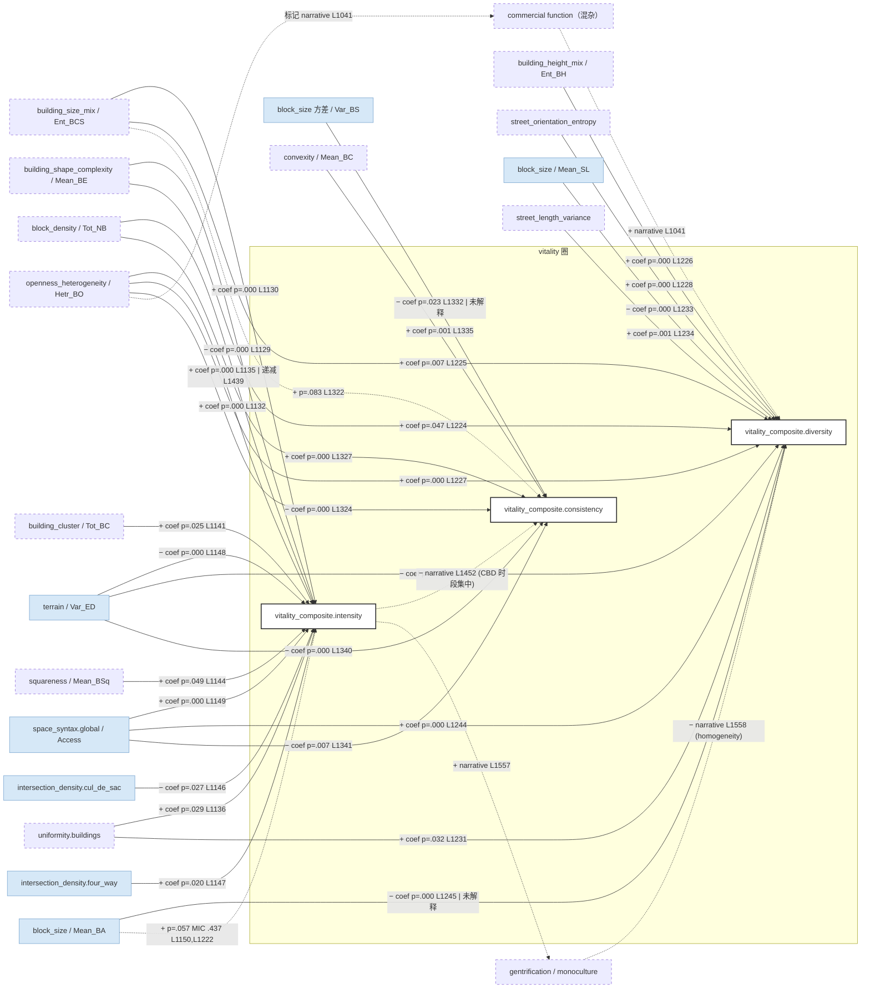

# Dogan & Lee 2024 (首尔) — per-paper CLD（模板 v2.1）

## 一段话

这篇的思路来自 Jacobs 的一句话："好的街区在不同时间有不同的活动。"作者把它拆成三个可以分开测的东西：**强度**（有多少人来，加上消费、POI、点评、Airbnb 五项合成）、**多样性**（来的是什么人——年龄和来源地够不够杂，加上 POI 种类）、**一致性**（一天里、一周里人来得均不均匀）。数据是首尔 1881 个 500 m 网格；三个指标的核心都是同一批手机流入记录的不同统计量，强度另外混入了刷卡、POI、点评、Airbnb，多样性另外混入了 POI 种类。（2026-10-06 共读时改，旧文：「数据是首尔 1881 个 500 m 网格的手机流入记录，三个指标都是从同一批数据算出来的不同统计量。」——强度与多样性并不全来自流入数据）

自变量是 22 个从建筑底图和路网算出来的形态指标，作者分成三组：**变异**（建筑大小、高度、街道朝向够不够多样）、**均匀性**（建筑和交叉口分布得均不均匀、街段长短差异大不大）、**连通性**（尽端路、四岔口、坡度、到全城的可达性）。每个活力指标各跑一次线性回归，再用 MIC 看哪些关系不是直线。

主要发现：建筑大小越杂，三个指标都高；坡度越大，三个都低。街区越多，强度和一致性越高，但越加越不明显。有两个因子方向分裂——建筑与开敞空间的异质性、到全城的可达性，都让强度和多样性上升、却让一致性下降。作者的解释是 CBD：人多、种类多，但只在某几个时段热闹。尽端路多的地方强度低，四岔口多的地方强度高。

对 CLD 的意义有三点。第一，同一个因子对三个指标符号不同不是矛盾，因为三个指标本来就是三种不同的量。第二，"可达性高 → 强度高但一致性低"这句话，作者进一步连到绅士化和功能单一化，等于说强度的集中会反过来侵蚀多样性——这是一条平衡回路的前半段，后半段（多样性下降之后怎么影响强度）作者没说。第三，系数只给到一位有效数字，所以这篇只能用符号，不能比大小。

## EN entry

Dogan & Lee (2024) take Jacobs's idea that good neighbourhoods host different activities at different times and split it into three measurable indicators for 1,881 grid cells (500 m) in Seoul: intensity (how many people come, combined with card spending, POIs, blog reviews and Airbnb listings), diversity (how mixed the visitors are by age and origin, plus POI variety) and consistency (how evenly visits spread across hours and weekdays). The core of all three is the same mobile-phone inflow data; intensity also folds in card spending, POIs, reviews and Airbnb, and diversity folds in POI variety, and POIs carry the largest loading in both (Fig. 5). (Fixed 2026-10-07; old text: "All three come from the same mobile-phone inflow data.") The explanatory variables are 22 form measures computed from building footprints and street centrelines, grouped as variety, uniformity and connectivity; each indicator gets its own linear regression, with MIC used to flag nonlinear relations. Mixed building sizes raise all three indicators and steep terrain lowers all three. More blocks raise intensity and consistency with diminishing returns. Two factors split: openness heterogeneity and city-wide accessibility raise intensity and diversity but lower consistency, which the authors attribute to CBDs that are busy only at certain hours. Cul-de-sacs lower intensity; four-way intersections raise it. For a CLD, opposite signs across the three indicators are not conflicts, because the indicators measure different things. The authors link concentrated intensity to gentrification and monoculture, which gives the first half of a balancing loop; the return path is not stated. Coefficients are reported to one significant figure, so only signs can be used.

## 0. 元数据

- Dogan, O., & Lee, S. (2024). Jane Jacobs's urban vitality focusing on three-facet criteria and its confluence with urban physical complexity. *Cities*, 155, 105446. https://doi.org/10.1016/j.cities.2024.105446（2026-10-07 按 txt L8–9 与 .bib 改正标题，旧文：「Jane Jacobs's urban vitality: Three facet criteria of intensity, diversity and consistency and their association with urban physical complexity in Seoul.」）
- txt：`literature/papers/Dogan-Lee-2024-Jane-Jacobs-Urban-Vitality-Three-Facet-Criteria.txt`（1870 行）；页码按 txt 页脚数字推断，未对 PDF 核
- **method-class**：`nonlinear-ml`（按分派）；实际 = 三个多元线性回归（Table 7，符号来自 OLS 偏效应，effect-type = direct）+ MINE MIC-R²（非线性强度，无形状、无符号）。没有 SHAP / PDP；唯一的形状描述是 Fig. 7（图依赖）
- 单元：500 m × 500 m 网格，1881 个（"Seoul's urban landscape was divided into 1881 units, each 500 m × 500 m" L511–512）；地域：首尔（单城）；样本期：建筑与路网 2020（L515），活力数据 2017–2022 混合（Table 5 年份列 L993–1002）
- review 表位置：表 A #19；异常旗标 T1 + T4
- batch-C 已核行号（L1065–1084、L1439–1479）本次全部重新 grep，多数行号有偏移（batch-C 的 L1072 → 本次 L1073 等）；batch-C 判 Table 7 "系数列打散"，本次按 22 变量固定块对齐后可对位（见 §3a）

## 1. DV

> "Using multisource datasets, including mobility, credit card purchases, POIs, and Airbnb data (Table 5), we created 10 vitality variables. Our model combines static data sources, like POIs, and dynamic data, like mobility flows, to ensure a rich representation of vitality." (L548–551, p.~5)
> "Then, we used Factor Analysis (FA) to reduce 10 variables into three indicators: intensity, diversity, and consistency." (L553–554)
> "Next, normalized values are multiplied by the factor loadings achieved with FA. … Then, combining the values of each category, we form three composite variables of vitality (Fig. 5)" (L604–608)

三个 DV（Table 5，L952–1009，p.~7）：

| DV | 成分（10 变量） | data | 子节点 |
|---|---|---|---|
| Intensity of vitality | 人口流入密度（"The number of trips ending in the unit area" L904）；经济活动密度（信用卡交易 L909）；POI 密度；博客点评密度；Airbnb 房源密度 | 首尔生活移动数据 2022；BC 卡 2020；Kakao POI 2020；Airbnb 2017 | **`vitality_composite.intensity`**（stock = 到达流量 + 消费 + 供给存量的合成；混合 `vitality_social`、`vitality_economic` 与 POI 供给） |
| Diversity of vitality | 流入人口年龄熵；来源地熵；POI 多样性（"Diversity of 13 POIs in the built area using the Simpson Index" L986–987） | 移动数据 2022；Kakao POI 2020 | **`vitality_composite.diversity`**（stock = 谁来 + 供给多样） |
| Consistency of vitality | 流入人口日内时段熵；周内日熵 | 移动数据 2022 | **`vitality_composite.consistency`**（stock = 到达流量的时间均匀度） |

三个 DV 是同一批流入人口数据的三种统计量（强度 = 总量，多样性 = 属性熵，一致性 = 时间熵），POI 密度 / 多样性作为供给成分混入前两个（review 表 T1）。

**FA 载荷（Fig. 5，p.7，2026-10-07 看 PDF 图补）**：强度 = 流入 0.52、刷卡 0.55、**POI 0.63**、点评 0.35、Airbnb 0.55；多样性 = 年龄熵 0.46、来源熵 0.43、**POI 多样性 0.65**；一致性 = 时段熵 0.64、周内熵 0.42。POI 在强度和多样性里都是**载荷最大**的一项，不只是「混入」。图里每个变量只连一个因子、没有交叉载荷，分组与 Table 5 的概念分组完全一致——FA 实际起的是「给预设分组定权重」的作用，不是从数据里发现三个维度（我们的推断，原文没报碎石图或交叉载荷）。

**DV 的量纲对不上（2026-10-07，我们的推断）**：方法写的是 0–100 归一后乘载荷再相加（L559–608），按此强度应在 0–260 左右；但 Fig. 7 的纵轴是强度 0–3、多样性 4–8、一致性 4–5.5，Table 7 系数乘以自变量全距也只有 0.1–0.4 量级。实际进回归的 DV 很可能另做了缩放（或用的是因子得分），原文没写。

**概念图和实际指标的落差**：Fig. 3（p.6，L620–666）列了夜光密度、社交媒体、收入 / 种族多样性、季节连续性、昼夜平衡，摘要里还有 living population data（L111），这些都没进 Table 5。sample-range：0–100 归一后 FA 加权（L559–608），具体分布未报告；Moran's I 0.4496 / 0.2908 / 0.2713（L1057–1060）。

## 2. 节点表

单元统一 500 m 网格，地域首尔；不重复。sample-range 来自 Table 4（L701–894，txt 按列拆行，Mean / SD / Min / Max / VIF 五列各 22 项可对齐）。**perspective 全部 top-down**（建筑底图 + 路网中心线；Hetr_BO 是 3D isovist 模拟的行人视点，不是街景，记 `top-down（模拟 eye-level）`）。

| 论文变量 | node | construct | indicator | sample-range (min / max / mean) | VIF | 组 | role |
|---|---|---|---|---|---|---|---|
| Mean_BE | `building_shape_complexity` **new-node** | 建筑轮廓复杂度 | 平均建筑边数 | 4.05 / 14.70 / 6.79 | 2.65 | 变异·建筑 | IV |
| Ent_BCS | `building_size_mix` **new-node** | 建筑尺寸混合 | 建筑覆盖尺寸熵 | 0 / 0.76 / 0.40 | 2.97 | 变异·建筑 | IV |
| Ent_BH | `building_height_mix` **new-node**（`building_height` 的熵变体） | 高度混合 | 建筑高度熵 | 0 / 0.80 / 0.60 | 2.53 | 变异·建筑 | IV |
| Hetr_BO | `openness_heterogeneity` **new-node**（近 `sky_view` 的异质性版） | 建筑–开敞异质性 | 3D isovist，行人视点（L584–586） | 0.01 / 0.94 / 0.57 | 2.84 | 变异·建筑 | IV |
| Ent_SO | `street_orientation_entropy` **new-node** | 街道朝向多样 | Boeing (2019) 朝向熵 | 0 / 0.91 / 0.79 | 1.61 | 变异·街道 | IV |
| Ent_SL | `street_length_entropy` **new-node** | 街段长度多样 | 街段长度熵 | 0 / 1 / 0.60 | 1.45 | 变异·街道 | IV |
| Tot_NB | `block_density`（indicator = 街区数） | 街区粒度 | 网格内街区总数 | 0 / 64 / 32.8 | 6.29 | 变异·街区 | IV |
| Uni_DB | `uniformity.buildings` **new-node** | 建筑分布均匀度 | box-counting（L587–590） | 0 / 2.19 / 1.85 | 2.30 | 均匀·建筑 | IV |
| Uni_DI | `uniformity.intersections` **new-node** | 交叉口分布均匀度 | 同上 | 0 / 1 / 0.81 | 1.24 | 均匀·街道 | IV |
| Mean_SL | `block_size`（indicator = 平均街段长 m） | 街区粒度 | 平均街段长度 | 0 / 3986 / 174 | 2.63 | 均匀·街道 | IV |
| Var_SL | `street_length_variance` **new-node** | 街段长度层级差异 | 街段长度方差 | 0 / 3270 / 154 | 2.20 | 均匀·街道 | IV |
| Var_BS | `block_size`（方差变体） | 街区尺寸差异 | 街区面积方差（1000 m²） | 0 / 29,056 / 933 | 1.41 | 均匀·街区 | IV |
| Tot_BC | `building_cluster` **new-node** | 建筑组团数 | 建筑聚类数（L595–596） | 0 / 17 / 3.99 | 1.40 | 连通·建筑 | IV |
| Area_BC | `building_cluster.area` | 组团面积 | 1000 m² | 0.22 / 246.7 / 91.4 | 3.58 | 连通·建筑 | IV |
| Mean_BC | `building_shape_complexity.convexity` | 建筑凸度 | 平均凸度 | 0.84 / 1 / 0.96 | 2.95 | 连通·建筑 | IV |
| Mean_BSq | `building_shape_complexity.squareness` | 建筑方正度 | 平均方正度 | 0.48 / 0.96 / 0.83 | 3.35 | 连通·建筑 | IV |
| Mean_SS | `street_sinuosity` **new-node** | 街道弯曲度 | 平均弯曲度 | 1 / 5 / 1.11 | 1.06 | 连通·街道 | IV |
| Tot_CS | `intersection_density.cul_de_sac`（负向连通） | 局部连通性 | 尽端路数 | 0 / 129 / 16.5 | 2.93 | 连通·街道 | IV |
| Tot_FW | `intersection_density.four_way` | 局部连通性 | 四岔口数 | 0 / 92 / 7.41 | 3.12 | 连通·街道 | IV |
| Var_ED | `terrain` | 地形 | 高程差方差 m | 0 / 4001 / 178 | 1.46 | 连通·街道 | IV |
| Access | `space_syntax.global`（方法未明，"accessibility to the rest of the city using the street network" L596–597） | 构型可达 | 全城可达性 | 1 / 197 / 115.5 | 1.29 | 连通·街道 | IV |
| Mean_BA | `block_size` | 街区粒度 | 平均街区面积（1000 m²） | 0 / 4109 / 7850（Mean 7849.90 大于 Max 4109.4，**原表数值自相矛盾**，按原文记） | 1.41 | 连通·街区 | IV |

DV 侧 perspective：人口流入 = transactional（移动数据）；信用卡 = transactional；POI / Airbnb = top-down；博客点评 = transactional（UGC）。

共线性：建筑数、街段数、平均圆度、交叉口总数因 VIF > 10 被剔除（"Variables such as the number of buildings, street segments, mean circularity, and total intersections were excluded because their VIF scores were >10" L542–543）；保留 22 个 VIF 最高 6.29（Tot_NB）。没有报告 IV 相关矩阵。

## 3. 边表

### 3a. 回归系数（`coef`，Table 7，L1076–1408，p.~8）— 三个 DV 分列

txt 把 Table 7 按 [强度 coef 22（L1129–1150）][显著性星号（不对齐，忽略）][强度 p 22（L1178–1199）][强度 MIC 22（L1201–1222）][多样 coef 22（L1224–1245）][多样 p（L1275–1296）][多样 MIC（L1298–1319）][一致 coef 22（L1321–1342）][一致 p（L1364–1385）][一致 MIC（L1387–1408）] 堆叠；变量顺序按 L1106–1127 表头。计数吻合，按序对齐，显著性以 p 值判定；**未对 PDF 核**。系数为未标准化、一位有效数字科学记数，幅度不可跨变量比较，下表只记符号、p 与 MIC-R²。R²：0.5666 / 0.5266 / 0.1793（L1152, L1247, L1344）；N = 1881。

| # | source | intensity（sign / p / MIC） | diversity（sign / p / MIC） | consistency（sign / p / MIC） | 备注 |
|---|---|---|---|---|---|
| 1 | building_shape_complexity (Mean_BE) | **−** / 0.000 / 0.161 | + / 0.047 / 0.157 | −* / 0.090 / 0.131 | "Mean_BE can sometimes decrease urban vitality, with lower vitality intensity in areas with more abundant irregular building surfaces" L1415–1417 |
| 2 | building_size_mix (Ent_BCS) | + / 0.000 / 0.108 | + / 0.007 / 0.135 | +* / 0.083 / 0.107 | 三指标皆正："positive associations with urban vitality in all three models" L1073–1074。**作者把它读成建筑年代混合**："These two results align with Jane Jacobs's idea that building age diversity and small block sizes enhance urban vitality." L1026–1027——量的是占地尺寸，不是年代（T6，2026-10-07 补） |
| 3 | building_height_mix (Ent_BH) | ns / 0.677 / 0.073 | + / 0.000 / 0.098 | ns / 0.805 / 0.119 | "significantly boosts the diversity" L1028–1029 |
| 4 | openness_heterogeneity (Hetr_BO) | + / 0.000 / 0.081 | + / 0.000 / 0.054 | **−** / 0.000 / 0.134 | "increases intensity and diversity while decreasing consistency" L1036 |
| 5 | street_orientation_entropy (Ent_SO) | ns / 0.388 / 0.101 | + / 0.000 / 0.033 | −* / 0.051 / 0.114 | L1034–1035 |
| 6 | street_length_entropy (Ent_SL) | ns / 0.379 / 0.166 | ns / 0.115 / 0.164 | ns / 0.341 / 0.113 | |
| 7 | block_density (Tot_NB) | + / 0.000 / 0.146 | ns / 0.320 / 0.163 | + / 0.000 / 0.111 | 递减非线性，见 3d |
| 8 | uniformity.buildings (Uni_DB) | + / 0.029 / 0.116 | + / 0.032 / 0.051 | ns / 0.213 / 0.119 | |
| 9 | uniformity.intersections (Uni_DI) | +* / 0.061 / **0.376** | ns / 0.269 / 0.246 | ns / 0.215 / 0.108 | MIC 高、线性弱：强非线性但作者未画 |
| 10 | block_size (Mean_SL) | ns / 0.112 / 0.184 | **−** / 0.000 / 0.015 | ns / 0.698 / 0.149 | "Neighborhoods with shorter streets … have more diverse vitality" L1457–1458 |
| 11 | street_length_variance (Var_SL) | ns / 0.594 / 0.204 | + / 0.001 / 0.081 | ns / 0.978 / 0.130 | "hierarchical diversity of street lengths helps" L1461 |
| 12 | block_size 方差 (Var_BS) | ns / 0.141 / **0.358** | ns / 0.476 / 0.149 | **−** / 0.023 / 0.103 | 强度模型 MIC 高线性 ns |
| 13 | building_cluster (Tot_BC) | + / 0.025 / 0.099 | ns / 0.167 / 0.093 | ns / 0.588 / 0.107 | |
| 14 | building_cluster.area (Area_BC) | ns / 0.926 / 0.087 | ns / 0.171 / 0.120 | ns / 0.562 / 0.106 | |
| 15 | convexity (Mean_BC) | ns / 0.553 / 0.133 | ns / 0.742 / 0.124 | + / 0.001 / 0.123 | "only Mean_BC demonstrates a positive association with vitality's consistency" L1465–1466 |
| 16 | squareness (Mean_BSq) | + / 0.049 / 0.112 | ns / 0.107 / 0.140 | ns / 0.244 / 0.109 | 正文说不显著（L1466），表 p=0.049 边缘 |
| 17 | street_sinuosity (Mean_SS) | ns / 0.720 / 0.150 | ns / 0.952 / 0.110 | ns / 0.221 / 0.099 | |
| 18 | cul_de_sac (Tot_CS) | **−** / 0.027 / 0.170 | +* / 0.084 / 0.165 | ns / 0.604 / 0.144 | "decreases the intensity" L1470–1471 |
| 19 | four_way (Tot_FW) | + / 0.020 / 0.110 | ns / 0.596 / 0.179 | ns / 0.222 / 0.108 | "increases the intensity" L1471–1472 |
| 20 | terrain (Var_ED) | **−** / 0.000 / 0.158 | **−** / 0.000 / 0.015 | **−** / 0.000 / 0.109 | 三指标皆负："streets with slopes tend to have lower activity levels, less diversity, and reduced consistency" L1030–1032 |
| 21 | space_syntax.global (Access) | + / 0.000 / 0.034 | + / 0.000 / 0.062 | **−** / 0.007 / 0.107 | "high Access has a negative association with the consistency" L1452 |
| 22 | block_size (Mean_BA) | +* / 0.057 / **0.437** | **−** / 0.000 / 0.107 | ns / 0.278 / 0.113 | 强度模型 MIC 最高（0.437）线性边缘：强非线性 |

（* = p < 0.10）

### 3b. 相关 / 共线性

只有 VIF（§2）。无相关矩阵。

### 3c. 间接 / 路径

无。

### 3d. 非线性与阈值（`interaction`，MINE MIC-R² + Fig. 7，L1418–1447，p.~9）

MIC-R² 只给"非线性强度"，不给形状与符号。作者文字描述的形状：

| # | 边 | 形状 | 原句 | 行 |
|---|---|---|---|---|
| I1 | block_density (Tot_NB) → intensity / diversity | 先增后趋平（递减） | "the total number of blocks (Tot_NB) exhibits a more nonlinear association with vitality's intensity and diversity. Increasing the number of blocks initially enhances vitality, but beyond a certain point, the influence diminishes. This suggests that while smaller blocks benefit urban vitality, excessively small blocks may not be necessary." | L1437–1441 |
| I2 | convexity (Mean_BC) → consistency | 非线性（形状未述） | "Similarly, mean building convexity (Mean_BC) has a more nonlinear association with vitality's consistency." | L1441–1442 |
| I3 | 更线性的组 | — | "For vitality intensity, variables such as Ent_BH, Hetr_BO, and Access exhibit more linear relationships. Ent_BCS, Mean_SL, and Var_ED show more linear patterns for vitality's diversity. Regarding vitality' consistency, Ent_BCS, the variance of the block size (Var_BS), and mean street sinuosity (Mean_SS) are more linear." | L1423–1428 |
| I4 | 阈值未报 | — | "the impact of block size is not linear on urban vitality, only up to a certain level small block is good for size and the diversity of vitality." | L1569 |

**未被文字解读的高 MIC**：Mean_BA 0.437、Uni_DI 0.376、Var_BS 0.358（强度模型）——线性都 ns 或边缘，说明这三条边可能是非单调，但作者没画也没说。Fig. 7 只画了 9 条（Hetr_BO / Tot_NB / Var_ED → intensity；Ent_BCS / Ent_BH / Tot_NB → diversity；Mean_BC / Tot_BC / Var_ED → consistency，L1430–1431），**形状图依赖**。

**Fig. 7 的曲线和文字有三处出入（2026-10-07 看 PDF p.9 补，图读，横轴被统一缩放到 0–10，缩放方法未写）**：① Tot_BC → consistency 曲线先平后**下降**，而线性系数为正（3E-04，p = 0.588）、文字说「more linear」（L1436–1437）；② Tot_NB → diversity 在高端明显回落，不只是「influence diminishes」（L1439–1440）；③ Mean_BC → consistency 是先降后升的 U 形，文字只说「more nonlinear」（L1441–1442）。Var_ED 三条曲线都在横轴近 0 处陡降后走平：Var_ED 偏态很重（均值 178、SD 380、最大 4001，Table 4），非线性主要落在数据最密的近零段。

**「更线性」里混着「没关系」（2026-10-06 共读补）**：作者把 MIC-R² 低读作「更线性」（"a smaller value suggests a more linear relationship" L1422–1423）。但 MIC−R² 低只说明 MIC 与 R² 接近，两者都接近 0 时也低，即根本没有关系。作者点名的「更线性」变量里有三个线性系数不显著：Ent_BH → intensity（p = 0.677，L1423–1424）、Tot_BC → consistency（p = 0.588，L1436–1437；还被选进 Fig. 7 作「higher impact」，L1429–1431）、Mean_SS → consistency（p = 0.221，L1426–1427）。这三条不能当「线性边」，应记 ns。

按 README 原则 3，I1 可以写成两个单调机制叠加：`block_density →(+) 街道界面/可达 →(+) intensity` 与 `block_density →(+) 街区过碎 →(−) intensity`（作者只给了第一段的机制"smaller blocks benefit"，第二段"excessively small blocks may not be necessary"没有机制）。

### 3e. 层级

无。

### 3f. Discussion 叙事（`narrative`）与负号解释

| # | 边 | 作者解释 | 方向判断 | 原句 | 行 |
|---|---|---|---|---|---|
| N1 | terrain → 三指标 − | 坡道活动少 | IV→DV | "streets with slopes tend to have lower activity levels, less diversity, and reduced consistency." | L1031–1032 |
| N2 | openness_heterogeneity → consistency −（同时 → intensity / diversity +） | Hetr_BO 高的地方是商业区；低的是窄巷老住区和高层公寓 | IV→DV，但实际是 `Hetr_BO ↔ 商业功能` 的混杂：Hetr_BO 是商业区的形态标记 | "It is lower in neighborhoods with very narrow streets, such as old residential neighborhoods with small paths, and in neighborhoods with limited high open space, such as high-rise apartment complexes. Therefore, most places with the highest Hetr_BO are commercial areas with high activity diversity." | L1037–1041, L1449 |
| N3 | space_syntax.global → consistency −（→ intensity / diversity +） | 最中心的地方某些时段用得多、其他时段少（CBD） | IV→DV；机制是"强度集中 → 时间不均"，即 **intensity ↑ → consistency ↓** 的 DV→DV 边 | "high Access has a negative association with the consistency of vitality. This means that the most central locations are used popularly in some periods of time but little in other time periods. Representative examples of this kind are some CBD areas, such as Jongro-gu, Yeouido, and Gangnam, which place less value on consistency but have a high level of total activity intensity" | L1452–1455 |
| N4 | convexity → consistency +；building_shape_complexity → intensity − | 首尔公寓小区建筑边数多、凸度高；这些地方强度低但一致性高 | IV→DV，且是"居住区 vs 商业区"的功能混杂：形态变量在代理 `functional_mix` / 居住占比 | "In Seoul, apartment blocks are designed with high convexity due to many building edges. In such places, vitality's intensity is low, but consistency is high." | L1468–1469 |
| N5 | block_size (Mean_SL) → diversity −；street_length_variance → diversity + | 短街段 = Jacobs 小街区；层级化街长也有利 | IV→DV | L1456–1462 | |
| N6 | cul_de_sac → intensity −；four_way → intensity + | 与前人一致，未给机制 | IV→DV | L1470–1473 | |
| N7 | **intensity 集中 → 同质化 / 绅士化**（DV→下游） | 强度聚集可能导致同质化；高强度低多样性 = 单一文化 | DV→下游（vitality → gentrification → diversity ↓） | "vitality intensity tends to cluster more than diversity and consistency, suggesting a possible link to gentrification, where increased activities might contribute to homogeneity." (L1556–1558)；"if there is high vitality intensity but low vitality diversity, it can mean gentrification or social and functional homogenization." (L495–496)；"Places with high vitality intensity but low vitality diversity can be classified as areas experiencing urban monoculture." (L1504–1505) | L1556–1558, L495–496, L1504–1505 |
| N8 | **vitality 的负外部性**：绅士化、隔离、拥堵、能耗、噪声 | DV→下游 | "it is essential to consider whether urban vitality can have negative impacts, such as gentrification, social segregation, traffic congestion, increased energy consumption, and noise pollution." | L1517–1519 |
| N9 | 高强度区吸引邻区访客（空间溢入） | DV→DV（邻格） | "Places with a high number of activities also attract visitors from neighboring areas." | L1601–1602 |
| N10 | 总括：变异 ↑、差异 ↓、连通 ↑ → vitality ↑ | — | "higher variety, lower disparity, and increased connectivity generally boost vitality." | L1559–1560 |

**负号清单**：Var_ED（N1，IV→DV）；Hetr_BO → consistency（N2，混杂解释）；Access → consistency（N3，实际是 DV→DV）；Mean_BE → intensity（L1415–1417，"irregular building surfaces"，IV→DV，机制弱）；Mean_SL → diversity（N5，方向是短街段好）；Tot_CS → intensity（N6，无机制）；Var_BS → consistency（p=0.023，**作者未解释**）；Mean_BA → diversity（p=0.000，**作者未解释**，且强度模型 MIC 0.437 最高）。

### 3g. Limitations（`limitation`）

**没有 limitations 小节**。5.1 末尾的未来研究（L1521–1540）只提年龄 / 性别不平等、微观尺度的非线性；没有承认反向因果、双向或自选择。但 N7–N9 三条 DV→下游 / DV→DV 叙事实质上是作者对回路的表述，进 §5。

### 3h. DV→DV

| # | 边 | 证据 | 行 |
|---|---|---|---|
| D1 | intensity → consistency − | N3：中心区强度高、一致性低；作者用 Access 的反号推出 | L1452–1455 |
| D2 | intensity 集中 → diversity ↓（经绅士化 / 同质化） | N7 | L1556–1558 |
| D3 | intensity（本格）→ intensity（邻格）+ | N9；**证据只有 Moran's I**：这句紧接在「intensity is more clustered」之后（L1600–1602），聚集是相关，推不出「吸引邻区访客」；况且 intensity 的成分就是流入人次，邻格访客本来就计在里面（2026-10-06 共读补） | L1601–1602 |
| D4 | 三指标空间聚集度：intensity 0.45 > diversity 0.29 > consistency 0.27 | Moran's I，Table 6 | L1057–1060 |

三个 DV 之间的相关矩阵未报告。

## 4. Mermaid

三个 DV 分列；只画 p < 0.05 的边；p < 0.10 与非线性用虚线。

## 5. 回路

| loop-id | segments | closed-in-paper | dominance-regime |
|---|---|---|---|
| B-绅士化 / 同质化（半条） | `intensity ↑ → gentrification / homogenization`（narrative L1556–1558；**作者的依据只是 intensity 的 Moran's I 比另两个高**，"intensity tends to cluster more … suggesting a possible link to gentrification" L1556–1558，本文没有任何绅士化数据，2026-10-06 共读补）；`gentrification → diversity ↓`（narrative L495–496, L1504–1505） | 否：两段叙事，且缺 `diversity ↓ → intensity` 的回段 | 作者定位在强度高度聚集的中心区；与 review 讨论 B1 多样性自毁同型，这里是用户多样性（年龄 / 来源地）而非业态 |
| B-时间集中（半条） | `intensity ↑（中心区）→ consistency ↓`（narrative L1452–1455，经 Access 的反号推出） | 否：DV→DV 叙事 | CBD |
| R-邻格溢入（半条） | `intensity（本格）→ intensity（邻格）`（narrative L1601–1602） | 否 | — |
| 递减（非回路） | `block_density → intensity` 先增后平（I1） | — | 阈值未报；operating range 0–64 块 / 500 m 格 |

**论文内无实证回路**：三个横截面 OLS；无 limitations 小节，未提反向因果。

**同一 IV 对三个 DV 反号不是冲突**：Hetr_BO、Access 对 intensity / diversity 正、对 consistency 负——consistency 是到达流量的时间熵，与强度是不同 stock（README §6）。整合时这两条负边应记在 `vitality_composite.consistency` 下，不与其他论文的 `space_syntax → vitality_presence +` 比较。

**形态变量代理功能**：N2、N4 都把形态变量的符号解释成"这种形态出现在商业区 / 公寓区"，即 `Hetr_BO`、`Mean_BC`、`Mean_BE` 在首尔是功能类型的标记。论文没控制功能混合或 POI 供给（它们在 DV 里），所以这些边有一部分是 `functional_mix → vitality` 的投影。

## 6. 提取备注

- **method-class 名不副实**：分派为 nonlinear-ml，但符号来自三个线性 OLS（Table 7），MINE 只给非线性强度（MIC-R²），无形状、无符号、无阈值。§3d 只有 Tot_NB 一条有文字形状。Fig. 7 九条曲线**图依赖，需人工看图**。建议提示词把"MINE / MIC"归入 regression + 非线性诊断，而不是 nonlinear-ml。
- **Table 7 可对位**：batch-C 记"系数列打散"，本次按 22 变量固定块对齐（§3a 开头列了各块行号），显著性用 p 值而非星号（星号列在 txt 里不对齐）。两处与叙事有出入：Mean_BSq → intensity p=0.049（正文说不显著）；Tot_NB → diversity 线性 p=0.320（正文说"nonlinear association with intensity and diversity"，指 MIC 0.163 而非线性系数）。均按表记。
- **系数幅度不可用**：未标准化、一位有效数字科学记数（如 5E-01、−2E-09），跨变量比较无意义；sample-range 已填 Table 4，整合时如需效应量要回 PDF 看是否有标准化版本。
- **Table 4 一处自相矛盾**：Mean_BA Mean 7849.90 > Max 4109.4（L802 vs L871），原表如此，按原文记并标注。
- **几何对象没有裁到格子里（转化层①，2026-10-07 补，我们的推断）**：500 m 格的对角线约 707 m、面积 0.25 km²，但 Mean_SL 最大 3 986 m、Var_SL 最大 3 270，Mean_BA 最大 4 109.4 × 1000 m² ≈ 4.1 km²（Table 4，PDF p.7 已核）。说明街段、街区是按「与格子相交的整条 / 整块」计的，测量尺度大于使用尺度：一个大公寓小区或山体街区会把同一个大数值带进它碰到的每一个格子。
- **名字和量纲（转化层④，2026-10-07 补，未能核实）**：Var_SL 叫 variance，均值 154、SD 224，与 Mean_SL（均值 174 m）同一量级，更像标准差而非方差（m²）；Var_ED 标单位 m，方差应为 m²。Uni_DB 用 box-counting（L587），最大值 2.194 超过平面上分形维数的上限 2，计算方式原文没写清。
- **Data availability**："Data will be made available on request."（L1734）
- **DV 是三个 FA 合成分**，全部挂 `vitality_composite` 加后缀；intensity 里混了 POI 密度和 Airbnb（供给），diversity 里混了 POI 多样性——review 表 T1。整合时 `building_size_mix → intensity +` 有一部分是"建筑尺寸混合 → 商业 POI 多"的供给传导。
- **词表缺行**：本篇 22 个变量里 15 个不在 §5 词表（建筑形状复杂度 / 尺寸熵 / 高度熵 / 开敞异质性 / 朝向熵 / 街长熵与方差 / 均匀度 ×2 / 建筑组团 ×2 / 凸度 / 方正度 / 弯曲度）。这些是"物理复杂度"一族，建议整合时先合并为 3–4 个 construct（`form_variety`、`form_uniformity`、`form_connectivity`、`block_grain`）再挂 ledger，否则节点爆炸。`intersection_density` 需要 `.four_way` / `.cul_de_sac` 子键（后者符号相反）。
- **三个 DV 分列的模板问题**：§3a 一行三组 (sign / p / MIC)，Mermaid 一条边画三次。与 Li21（三维）、Wu23（昼夜）同样的问题，建议模板允许 target 写 `vitality_composite.{intensity,diversity,consistency}` 并在边标签里用 `/` 分隔三个符号。
- **两个作者未解释的显著负号**：Var_BS → consistency（p=0.023）、Mean_BA → diversity（p=0.000）。进整合冲突清单时标"无作者解释"。
