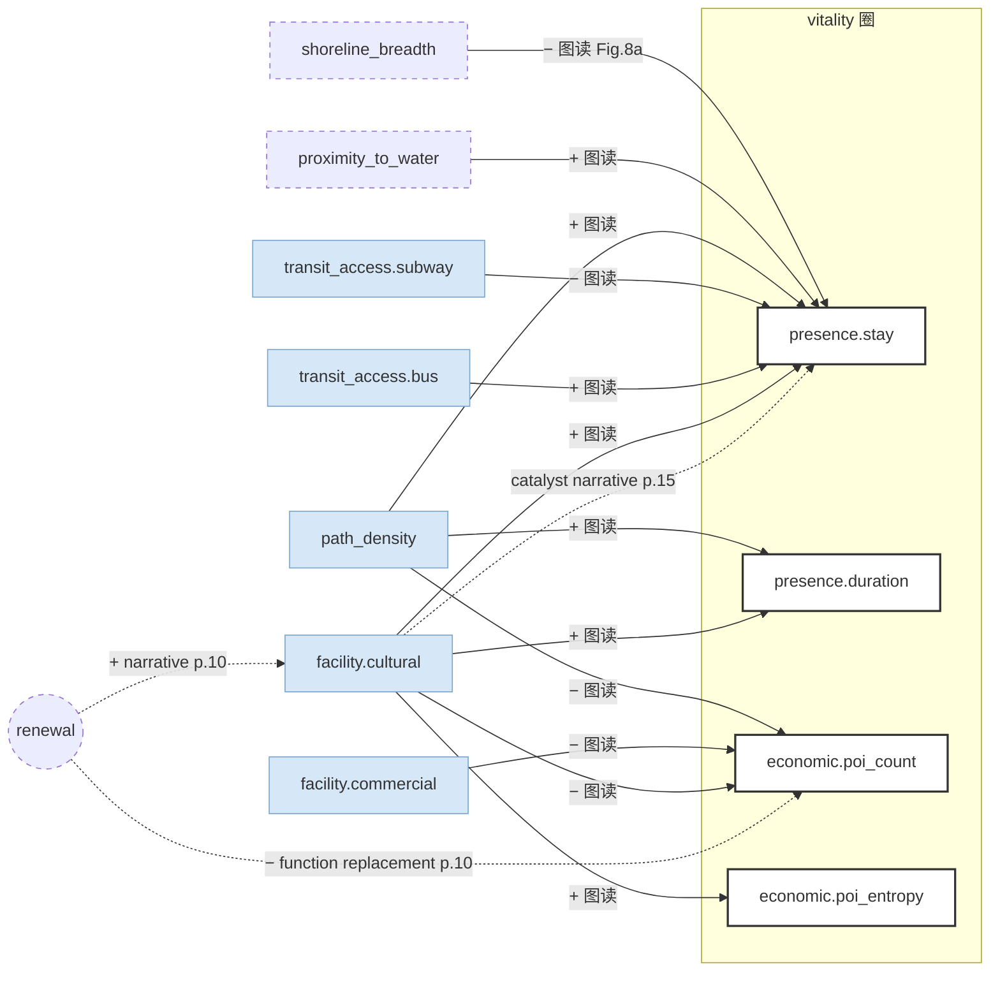

# Fan, Kuang, Tu & Ye 2023（深圳茅洲河，改造前后两期）— per-paper CLD（模板 v2.1）

2026-10-08 共读后提取。无 txt，引用为 PDF 页码（p.N）；Fig. 8 的系数是看图读的近似值（标「图读」），不是表格数字。

## 一段话

作者看的是一条河改造前后的变化：茅洲河 61 个岸线单元（离水 10–50 m 的带），取 2018 年 10 月（改造前）和 2020 年 10 月（改造后）两期，把 11 个空间要素和 15 个活力指标都换成增长率，每个活力指标各跑一个线性回归。活力分两类：社会活力来自手机信令里的停留人数（居住、工作、访问三类人）和访客停留时长；经济活力来自周边 POI 个数和种类的熵。主要发现：步道密度和文教设施密度的增加，对停留人数和停留时长都是最大的正作用；地铁站覆盖是负的或无效（郊区站点离河太远）。最有意思的是一个反号：同样这些要素，对「经济活力强度」（周边企业、商业 POI 数）大多是**负**的。作者的解释是功能替代：工业码头、仓库被换成展馆和公园，企业和商业减少、文教设施增加。用 CLD 看，这是一条改造挤出原有经济功能的平衡关系，只在叙事里，没有估计。这篇是我们读过的唯一有前后两期的研究，增长率对增长率相当于拿每个单元自己的过去当对照，但没有对照河段，又叠加了疫情。

## EN entry

Fan et al. (2023) track the Maozhou River renewal in Shenzhen across two periods, October 2018 (before) and October 2020 (after), on 61 shoreline units 10–50 m wide. Eleven spatial elements (scale, design, accessibility, function) and fifteen vitality indicators are converted to growth rates, and each indicator gets its own linear regression. Social vitality comes from mobile-phone stays (dwellers, workers, visitors) and visitors' stay duration; economic vitality from the number and Shannon entropy of POIs in a 15.8 km² influence area, projected onto the units with a distance-decay weight (β = 1.8, set rather than fitted). Path density and cultural-educational facility density show the largest positive associations with stays and stay duration; subway coverage is negative or null, which the authors attribute to suburban stations lying beyond walking distance of the river. The same design and function elements are mostly negatively associated with economic intensity (enterprise and commercial POIs), which the authors explain as function replacement: industrial wharves and warehouses became exhibition halls and parks. For a CLD this is a balancing relation, renewal displacing existing economic functions, stated in the discussion but not estimated. It is the only study we have read with a before–after design: regressing changes on changes uses each unit as its own control, but there is no untreated reach and the 2020 period falls in the pandemic.

## 0. 元数据

- Fan, Y., Kuang, D., Tu, W., & Ye, Y. (2023). Which spatial elements influence waterfront space vitality the most?—A comparative tracking study of the Maozhou River renewal project in Shenzhen, China. *Land*, 12(6), 1260. https://doi.org/10.3390/land12061260
- 文本：无 txt；PDF 在 `~/Downloads/Fan-2023-…pdf`（wafo-base 未入库）
- method-class：regression（15 个 OLS，增长率对增长率；Durbin–Watson + VIF < 6）
- 单元：61 个岸线单元（离水 10–50 m，共 1.3 km²）；影响区 500–1000 m（15.8 km²）（p.3）；地域：深圳茅洲河（单案例、郊区）；样本期：2018.10 / 2020.10（p.7）

## 1. DV（均为增长率 Δ = (2020 − 2018) / 2018，p.9）

| 论文变量 | node | 测的是什么 | 数据 | 投影 |
|---|---|---|---|---|
| Y1 社会活力强度（Y11 居住 / Y12 工作 / Y13 访问停留人数） | `vitality_presence.stay`（按人群分） | 停留 ≥ 30 分钟；21:00–08:00 记居住，09:00–17:00 记工作，其余记访问（Table 2 注，p.7） | 运营商信令，443 个基站（删 24 个新站） | 泰森多边形（p.10） |
| Y2 社会活力质量（Y21–Y24 访客停留时长，工作日 / 周末 × 白天 / 晚上） | `vitality_presence.duration` | 访客停留总时长 | 同上 | 同上 |
| Y3 经济活力强度（Y31 企业 / Y32 商业 / Y33 文教娱乐 / Y34 公共服务 POI 数） | `vitality_economic.poi_count` | 周边功能设施的数量变化 | 地图 POI（10 772 / 10 244 条） | 距离衰减 d^−1.8（p.9） |
| Y4 经济活力质量（Y41 功能多样性） | `vitality_economic.poi_entropy` | Shannon 熵 / ln k | 同上 | 同上 |

Y31（企业）模型不显著（p = 0.144，R² 0.26，p.10）。

## 2. 节点表（全部是增长率）

| 变量 | node | indicator | data | perspective |
|---|---|---|---|---|
| X1 岸线宽度 | `shoreline_breadth` new-node | 单元平均岸线开敞宽度 | 遥感 + 设计文件 | top-down |
| X2 亲水性 | `proximity_to_water` new-node | 人工 1–4 级（防洪设施高度、能否看到水） | 现场调查 | eye-level（人工评级） |
| X3 慢行道密度 | `path_density` | 步行 / 跑步 / 自行车道面积 ÷ 单元面积 | 设计文件 | top-down |
| X4 慢行道出入口密度 | `path_entrance_density` new-node | 出入口数 ÷ 单元面积 | 同上 | top-down |
| X5 交通连续性 | `traffic_continuity` new-node | C = 1 / 连接两岸的桥数（Table 1，p.6） | 同上 | top-down |
| X6 地铁站覆盖 | `transit_access.subway` | 800 m 缓冲内站数 | — | top-down |
| X7 公交站覆盖 | `transit_access.bus` | 同上 | — | top-down |
| X8 停车设施密度 | `parking_density` new-node | 同上 | — | top-down |
| X9 商业休闲设施密度 | `facility.commercial`（单元内） | 餐饮、购物、住宿、运动休闲 | 未单独说明 | top-down |
| X10 文教设施密度 | `facility.cultural`（单元内） | 科普、教育、文化、景观 | 未单独说明 | top-down |
| X11 公共服务设施密度 | `facility.public_service`（单元内） | 报亭、厕所、应急避难 | 未单独说明 | top-down |

## 3. 边表

### 3a. 系数（`coef`，Fig. 8，p.14，图读近似值；标准化与否原文没写）

Fig. 8a 四个汇总 DV：

| X | → Y1 停留人数 | → Y2 停留时长 | → Y3 周边 POI 数 | → Y4 POI 熵 |
|---|---|---|---|---|
| X1 岸线宽度 | **−** ≈ −0.27 | ≈ 0 | − ≈ −0.11 | ≈ 0 |
| X2 亲水性 | **+** ≈ 0.22 | + ≈ 0.13 | ≈ 0 | ≈ 0 |
| X3 慢行道密度 | **+** ≈ 0.58 | **+** ≈ 0.53 | **−** ≈ −0.40 | + ≈ 0.15 |
| X4 出入口密度 | −（浅色，ns） | −（ns） | ≈ 0 | ≈ 0 |
| X5 交通连续性 | + ≈ 0.12 | + ≈ 0.10 | ≈ 0 | + ≈ 0.20 |
| X6 地铁站覆盖 | **−** ≈ −0.23 | − ≈ −0.15 | − ≈ −0.16 | + ≈ 0.09 |
| X7 公交站覆盖 | **+** ≈ 0.24 | + ≈ 0.16 | ≈ 0 | ≈ 0 |
| X8 停车密度 | ≈ 0 | ≈ 0.07 | − ≈ −0.16 | + ≈ 0.24 |
| X9 商业休闲设施 | + ≈ 0.16 | + ≈ 0.18 | **−** ≈ −0.20 | + ≈ 0.18 |
| X10 文教设施 | **+** ≈ 0.42 | **+** ≈ 0.39 | **−** ≈ −0.30 | **+** ≈ 0.35 |
| X11 公共服务设施 | ≈ 0 | ≈ 0 | + ≈ 0.15 | + ≈ 0.13 |

Fig. 8b（停留人数按人群）：系数绝对值普遍是**居住 > 工作 / 访问**，例如 X3 → 居住 ≈ +0.62、访问 ≈ +0.47；X1 → 居住 ≈ −0.45；X4 → 居住 ≈ −0.40；X6 → 居住 ≈ −0.37。
Fig. 8d（周边 POI 按类别）：同类配对为正（X9 → 商业 POI ≈ +0.16，X10 → 文教 POI ≈ +0.28，X11 → 公共服务 POI ≈ +0.15），跨类多为负（X10 → 公共服务 POI ≈ −0.24，X11 → 文教 POI ≈ −0.27）；X3 → 商业、公共服务 POI 都负。

显著性：图上星号标在每个 X 旁，不分 DV（`**` p < 0.05，`*` p < 0.1），浅色条推测为不显著；无法逐格判定，所以表里只按条形深浅和大小加粗，不报 p。

### 3b. 相关 / 筛选
VIF 均 < 6（p.12）；作者把 Durbin–Watson 说成检验了共线性（p.10），实际 DW 检验的是残差自相关。

### 3c. 路径 / 3d. 非线性 / 3e. 层级
无。全部线性。

### 3f. 叙事（`narrative`）

| # | 边 | 作者解释 | 页 |
|---|---|---|---|
| N1 | 文教、商业等功能设施 → 停留 + | 设施是「catalysts」，每 500–800 m 一个大节点、200–300 m 一个小节点，刺激停留激增 | p.15 |
| N2 | 改造 → 企业、商业 POI −；文教设施 + | 「function replacement」：工业码头、仓库改成展馆和公园；疫情也压低企业数 | p.10、p.13 |
| N3 | 地铁站覆盖 → 活力 −/无 | 郊区站点密度低、离河 500 m 以上，不适合步行 | p.15 |
| N4 | 岸线宽度 → 活力 弱 / − | 太宽降低可达和亲水，太窄难做设计和多样性（作者描述的是倒 U，但只估了线性） | p.15 |
| N5 | 亲水性按视野算 → 显著；按距离（岸线宽度）算 → 弱 | 同一个「近水」概念，两种操作化给出不同结果 | p.15 |

### 3g. Limitations
疫情影响无法剔除；计划再追踪 5–10 年；信令的距离衰减投影需进一步验证（p.16）。没有承认反向因果或缺对照组。

### 3h. DV→DV
无估计。Fig. 6 只画了社会 vs 经济、强度 vs 质量的散点象限（p.12）。

## 4. Mermaid

## 5. 回路

| loop-id | segments | 论文内闭合 | 备注 |
|---|---|---|---|
| B-功能替代（半条） | 改造 → 文教、公园设施 ↑（N2）；改造 / 慢行道、文教 ↑ → 周边企业、商业 POI ↓（Fig. 8a 的 Y3 负号 + N2） | 否 | 回段（企业减少之后怎样影响停留或下一轮改造）没写；与 Dogan 的绅士化、Gómez-Varo 的「成功之死」同属 B 族，但方向是公共功能挤出私人经济功能 |
| R-催化（半条） | 功能设施 → 停留 ↑（N1） | 否 | 「停留增加 → 吸引新设施」的回段没写；经济 POI 在两年内反而下降，至少短期内这个 R 没有启动 |

**设计上的意义**：增长率对增长率，等于用每个单元改造前的自己作对照，消掉了位置这类不随时间变的混杂；但没有未改造的对照河段，城市整体趋势和疫情都混在增长率里。

## 6. 提取备注

- **2026-10-08 更正我们自己的判断（台账里写过）**：原写「X9–X11 与 Y32–Y34 是同一组设施类别，『功能维度影响最大』有一部分是用设施数解释设施数（T1）」。看 Fig. 8 后不成立：X 是岸线单元（10–50 m 带）里的设施，Y 是 500–1000 m 影响区里的 POI，两个空间范围；汇总后 X9、X10 对 Y3 是**负**的，只有同类配对为正。概念上这是「公园里建了什么设施 → 周边经济功能怎么变」，是一条跨范围的边，不是同一个量。
- **经济活力是不是 T4**：截面研究里 POI 数是供给存量；这里 DV 是两期之间的**变化**，周边开店、关店是对改造的市场响应，概念上可以当响应来读。操作上的问题在投影：POI 总数下降（p.10）而投影后的强度上升 27.24 %（p.9），说明投影值部分反映的是设施离河多近。用户 2026-10-08 定：不标 T4。
- **p.12 与 p.13 不矛盾（更正 2026-10-08 报告里的说法）**：p.12 说空间要素对访客的**解释力**更强（调整 R² 访客 0.63 > 居住 0.41），p.13 说对居民的**影响**更明显，指的是 Fig. 8b 的系数大小（居住 ≈ +0.62 vs 访问 ≈ +0.47）。一个是 R²、一个是系数，可以同时成立。
- **X5 名称与计算**：C = 1 / 桥数，桥越多「连续性」越低。若作者的意思是桥打断沿河步道，概念说得通；若意思是两岸连通，公式就反了。原文没解释。
- **「居住」的判定**：夜间 21:00–08:00 停留记居住，Fig. 8b 里系数最大的恰是「居住」。新建公园夜间的使用者、附近新入住的人都会落进这一类，所以「服务人群有没有变」在这个分类下分不出来（我们的推断）。
- **增长率的分母**：改造前为 0 的要素（如原本没有慢行道的单元）增长率无定义，原文没交代（见 `skeleton/open_questions.md` C1）。
- **疫情与 Y31**：企业模型不显著，作者把企业减少主要归因于疫情和功能替代。
