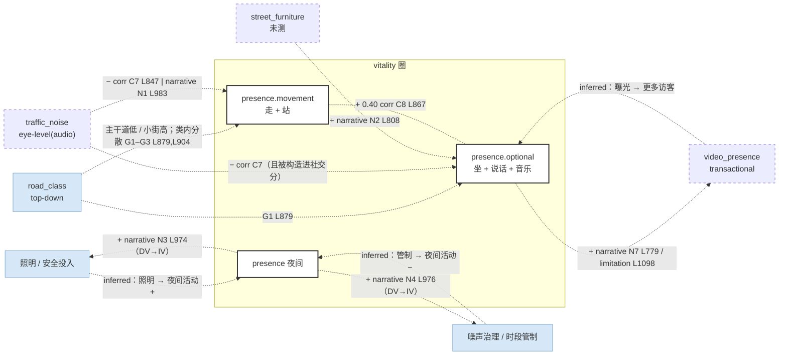

# Gu et al. 2027（Melbourne CBD, Street View Video）— per-paper CLD（模板 v2.1）

## 一段话

作者把 YouTube 上 "Melbourne city walk" 步行视频（1 602 条，筛后 892 条，801 白天、91 夜间）当作一种新数据，叫街景视频（SVV），先用招牌文字识别 + 深度估计把每 10 秒的画面定位到 50 m 路段，再从画面里数行人、分出走 / 站 / 坐，从声音里算音量、分出说话 / 音乐 / 车辆。论文主要回答"这种数据能不能用"，不是"活力由什么决定"：没有回归，只有相关矩阵和一个按道路等级分组的象限图。对我们最有用的是它把人的活动按 Gehl 分成两类：走和站算"移动"（必要性活动），坐、说话、音乐、减去车辆声算"社交"（选择性活动）。结果是主干道两项都偏低、小街两项都偏高，但每类道路内部差异很大，作者结论是"道路等级本身不足以解释街道活力"。用 CLD 看：几乎全是相关和叙事边；有两条半回路值得记——夜间活跃的街道会招来照明和安全投入（R 半条）、住宅区的夜间噪声会招来管制（B 半条）；还有一条数据生产的回路：热门街道被拍得更多，网上曝光更高，又更热门。

## EN entry

Gu et al. (2027) propose Street View Video (SVV) as a data type and test it on 892 YouTube "Melbourne city walk" videos (801 day, 91 night) in Melbourne's CBD. Frames are geolocated to 50 m street segments by matching OCR-read shop and street signs against OpenStreetMap, with depth estimation to place the observer (77.19% agreement with creator timestamps, computed only on recognised segments). From each 10-second clip they count pedestrians (YOLOv11 + tracking), classify actions as walking, standing or sitting (zero-shot X-CLIP), and measure sound intensity and type (speech, music, vehicle; PANNs). The paper is a proof of concept, not an explanatory model: it reports a correlation matrix and a quadrant analysis by OpenStreetMap road class. Following Gehl, walking and standing form a "movement" score (necessary activity) and sitting, speech, music and inverted vehicle sound form a "social" score (optional activity). Major roads sit low on both and local streets high on both, but within-class spread is large, so road hierarchy alone does not explain street vitality. Vehicle sound correlates negatively with all pedestrian actions; walking correlates with speech (R = 0.43). Against 38 city sensors, night-time SVV counts correlate at 0.60 and daytime at only 0.30, while static Google Street View reaches 0.65. The authors acknowledge survivorship bias: creators film touristic, popular streets, so SVV is "not a population-representative measure of urban vitality". For CLD purposes the paper offers correlational edges, a necessary/optional split of the vitality node, and narrative half-loops (night activity attracting lighting investment; night noise attracting regulation).

## 0. 元数据

- Gu, Y., Liang, X., Fan, Z., Hou, Y., & Biljecki, F. (2027). Street view video for urban sensing: Potential for measuring urban vitality. *Computers, Environment and Urban Systems*, 131, 102509. https://doi.org/10.1016/j.compenvurbsys.2026.102509 （accepted manuscript）
- txt：`literature/papers/Gu-et-al-2027-Street-View-Video-Urban-Vitality.txt`（2026-10-04 用 PyMuPDF 从 PDF 生成，1 632 行；`[end of PDF page N]` 标记该页结束，所以 p.X = 上一个标记之后的行）
- **method-class**：`descriptive`（相关矩阵 + 象限分组，无回归）
- 单元：50 m 路段（L127–129）；验证用 38 个传感器各 30 m 缓冲（L1015–1020）
- 地域：墨尔本 CBD；样本期：视频检索截至 2026 年 2 月（p.16），录制日期不可知（L1107–1110）
- 不在 `vitality_indicators_review.md` 的表里（新读论文）

## 1. DV

> "It encompasses not only the intensity of economic and social activities, but more fundamentally reflects the potential of urban space to support human engagement" (L46–48, p.2)
> "Among its various dimensions, street-level social dynamics are widely recognized as one of its most direct and visible expressions" (L50–51)
> "This study focuses exclusively on pedestrians, as they represent the most prevalent form of street-level human activity and have been widely adopted as a key proxy for vitality" (L501–502, p.12)
> "The movement dimension represented necessary activities in Gehl (2011)'s framework, while the social interaction dimension captures optional and social activities." (L857–859, p.21)

不是合成成一个指数，而是并列多个维度，再合成两个分：

| 量 | 子节点 | 说明 |
|---|---|---|
| 行人数（白天 / 夜间 / 全部） | `vitality_presence` | 每 50 m 路段每 10 秒片段的平均人数 |
| 走、站 | `vitality_presence.movement` **new-node** | Gehl 必要性活动；"站"多在路口等红灯（L807–808） |
| 坐、说话声、音乐声 | `vitality_presence.optional` **new-node** | Gehl 选择性 / 社交活动 |
| 移动分 / 社交分 | 同上两节点的合成 | z 分数后不加权平均；车辆声取反后进社交分（L861–866） |
| 音量 dB | `sound_intensity` **new-node** | 人声和车声混在一起，不纯是活力 |

命名提示：词表里 `vitality_social` 已经指"到达 / 出发流量"（Li21 OD），所以这里不用 `vitality_social`，见 §6。

## 2. 节点表

| 论文变量 | node | construct | indicator | data | unit-scale | sample-range | perspective | role |
|---|---|---|---|---|---|---|---|---|
| Pedestrian count | `vitality_presence` | 在场人数 | YOLOv11 + BoT-SORT 人数 | YouTube city walk 视频 | 50 m 路段 | 最高 59 人 / 段（p.18）；人工样本均值 23.83（Table 2） | eye-level（人行道高度） | DV |
| Walking / Standing | `vitality_presence.movement` **new-node** | 必要性活动 | X-CLIP 零样本动作 | 同上 | 同上 | 走占 80% 以上（L806） | eye-level | DV 维度 |
| Sitting | `vitality_presence.optional` **new-node** | 选择性活动 | 同上 | 同上 | 同上 | 未报告 | eye-level | DV 维度 |
| Speech / Music | `vitality_presence.optional`（声音 indicator） | 社交 / 街头表演 | PANNs 前 3 标签概率 | 视频音轨 | 同上 | 未报告 | eye-level（音频）——建议新增 `ear-level`，见 §6 | DV 维度 |
| Vehicle sound | `traffic_noise` **new-node** | 机动车主导 | PANNs 车辆概率 | 视频音轨 | 同上 | 未报告 | eye-level（音频） | 进社交分时取反 |
| Sound intensity | `sound_intensity` **new-node** | 声环境强度 | RMS → dB | 视频音轨 | 同上 | 未报告 | eye-level（音频） | DV 维度 |
| Road class | `road_class` **new-node** | 道路等级 | OSM highway 四类（Table 5） | OSM | 路段 | — | top-down | 分组变量 |
| Video presence | `video_presence` **new-node** | 采样覆盖 / 网络注意力 | 每段路出现在多少条视频里 | YouTube | 路段 | 1–254 次（L776, L785–786） | transactional（UGC） | 采样权重，不是 IV |
| Public seating（叙事） | `street_furniture`（Chen24 已提议） | 街道家具 | 未测，作者看图叙述 | — | — | — | — | 叙事 |

## 3. 边表

### 3a. 系数

无（不做回归）。

### 3b. 相关与分组（`corr` / `bivariate`，Fig. 10–11，Table 5）

| # | 对 | 符号 / 值 | 原句 | 行 |
|---|---|---|---|---|
| C1 | 白天行人数 – 夜间行人数 | ns | "no significant correlation was shown between daytime and nighttime totals" | L837–838 |
| C2 | 白天行人数 – 夜间音量 | − | "a negative relationship was observed between daytime pedestrian counts and nighttime sound intensity, reflecting distinct temporal usage patterns and potential sampling bias in limited nighttime data" | L838–840 |
| C3 | 行人数 – 音量 | + 0.15（白天 0.13，夜间 0.50） | "Pedestrian counts and sound intensity were weakly correlated (R = 0.15), with stronger relationships at night (R = 0.50) than during the day (R = 0.13)" | L840–842 |
| C4 | 走 / 站 / 坐 两两 | + | "clear positive correlations were observed among pedestrian behaviors (walking, standing, sitting)" | L843–844 |
| C5 | 说话 – 音乐 | + 0.16 | "except for a weak positive correlation between speech and music (R = 0.16)" | L845–846 |
| C6 | 走 – 说话 | + 0.43 | "walking correlated positively with speech (R = 0.43)" | L846–847 |
| C7 | 车辆声 – 所有行人行为 | − | "vehicle noise correlated negatively with all pedestrian behaviors, reflecting reduced pedestrian presence in vehicle-dominated spaces." | L847, L851 |
| C8 | 移动分 – 社交分 | + 0.40 | "The overall scatter distribution showed a moderate positive correlation (R = 0.40)" | L867–868 |
| G1 | road_class → 两个分（组均值） | 主干道低 / 小街高 | "major streets are associated with lower levels of pedestrian-related activities and urban vitality, while local streets tend to exhibit higher levels of both movement and social activities" | L879–881 |
| G2 | road_class 内部移动–社交相关 | 主干道 0.51，小街 0.21 | "Major streets showed the strongest correlation (R = 0.51)…local streets showed the weakest correlation (R = 0.21)" | L896–898 |
| G3 | road_class 的解释力 | 弱 | "Yet, road hierarchy alone is insufficient to clearly distinguish the differences" | L904 |

**测量对照（不是因果边，记在这里供 indicator ledger 用）**：SVV–GSV 0.28、SVV–Mapillary 0.26、GSV–Mapillary 0.51，均值 19.6 / 5.8 / 2.0（L1008–1011）；传感器–SVV 夜 0.60、传感器–GSV 0.65、传感器–Mapillary 0.56、传感器–SVV 昼 0.30（L1022–1024）。

共线性：不适用（无回归）。注意社交分的构造用了 C7：车辆声因为和行人负相关才被取反放进社交分（L861–865），所以"社交分与车辆声负相关"部分是构造出来的。

### 3c–3e

无。

### 3f. Discussion 叙事（`narrative`）

| # | 边 / 链 | 方向 | 原句 | 行 |
|---|---|---|---|---|
| N1 | traffic_noise（机动交通）→ 步行 − | IV→DV（引文献原则） | "further supporting the long-held urban planning principle that reducing traffic flow at the street level is critical for promoting walkability" | L983–984 |
| N2 | street_furniture → 坐 + | IV→DV（看图） | "certain higher values corresponded to segments with ample public seating (e.g., Hardware Ln, parts of Flinders St and Little Bourke St)" | L808–810 |
| N3 | 夜间活动 → 照明、安全投入（→ 夜间经济） | **DV→IV**（规划响应） | "streets characterized by strong nighttime activity may benefit from interventions that support the nighttime economy, such as improved lighting and safety measures" | L974–975 |
| N4 | 夜间活动 → 噪声治理 / 时段管制（住宅区） | **DV→IV**（规划响应，抑制方向） | "in residential areas, these patterns may signal the need for noise mitigation or temporal regulations" | L976–977 |
| N5 | 微观情境（沿街界面活跃度、感知品质）→ 街道活力 | IV→DV（假说，未测） | "street vitality might also be shaped by micro-scale contextual factors such as building frontage activity and the perceptual qualities of street environments" | L996–998 |
| N6 | 移动主导 → 交通稳静化 / 拓宽人行道；社交主导 → 保持步行优先 | DV→干预 | "movement-dominated corridors may benefit from traffic calming or widened sidewalks, while socially active streets may require preserving pedestrian priority and minimizing through-traffic" | L989–991 |
| N7 | 热门街道 → 更多视频 → 网上曝光 ↑ | 数据生产 | "likely reflecting the popularity of these well-known streets among video creators, which in turn further amplifies their visibility online" | L778–779, L785 |

负号：C7 车辆声（N1 解释，IV→DV）；C2 白天人数–夜间音量（作者解释为时段用途不同 + 夜间样本少，L839–840）。

### 3g. Limitations（`limitation`）

| # | 内容 | 类型 | 原句 | 行 |
|---|---|---|---|---|
| L1 | 拍哪条街由游客口味决定：幸存者偏差 | 采样 / 自选择 | "more vibrant places of higher touristic appeal are more likely to be captured by city tour videos to begin with, to attract views, while other places are much less visible" | L1098–1100 |
| L2 | 录制时间不可知，不能对齐高峰、天气 | 时间 | "SVV rarely provides verifiable recording times, as the upload date of a video may differ significantly from its actual recording date" | L1108–1109 |
| L3 | 不代表人口 | 外推 | "While not a population-representative measure of urban vitality" | L1164 |
| L4 | 无招牌处（公园、河边）定位失败 | 覆盖 | p.16, p.27 | |

L1 本身是一条反向因果：活力 → 被拍 → 数据存在。

### 3h. DV→DV

C4、C6、C8 是 DV 维度之间的相关；无方向。

## 4. Mermaid

只有虚边（corr / narrative / limitation）。

## 5. 回路

| loop-id | segments | closed-in-paper | dominance-regime |
|---|---|---|---|
| R-夜间经济 | 夜间活动 → 照明 / 安全投入（N3，L974–975）；照明 → 夜间活动（inferred） | 否（只有前半） | 商业街 |
| B-噪声管制 | 夜间活动 → 噪声治理 / 时段管制（N4，L976–977）；管制 → 夜间活动 ↓（inferred） | 否（只有前半） | 住宅区（作者明确按区域分开，L975–976） |
| R-注意力 | 热门 → 被拍（L1098–1099）→ 网上曝光 ↑（L779）→ 更多访客（inferred） | 否（前两段有原文） | 游客导向的街道 |

R-夜间经济与 B-噪声管制共用一个起点，作者用"商业 vs 住宅"作为切换条件，这是论文给出的唯一一个 dominance 条件。

## 6. 提取备注

- **necessary / optional 是按动作分的，不是按时间分的**：走 = 必要、坐 = 选择，但散步也是走、等公交也是坐。录制时间不可知（L2），所以无法再用工作日 / 周末 / 节假日去区分。整合时这两个子节点的 indicator 要标"按动作类型近似"。
- **社交分的构造与 C7 循环**：车辆声因为与行人负相关才被取反放进社交分（L861–865）。整合时"traffic_noise → optional"不能用社交分作证据，只能用 C7 的单项相关。
- **"站"的识别不可靠**：r = 0.35，偏少（Table 2，L527–528），却被放进移动分。
- **词表冲突**：`vitality_social` 已被 Li21 的 OD 流量占用。建议 v3 把 vitality 子节点按 Gehl 拆出 `vitality_presence.movement` / `.optional`，并把 Li21 的改名为 `vitality_flow`。
- **perspective 缺值**：音频不是 eye-level，建议加 `ear-level`（或 `eye-level.audio`）。
- **传感器年份不一致**：Fig. 3 图注写 "across the entire 2024"（L390），正文写 "annual average pedestrian counts recorded by the sensors in 2025"（L1016–1017）。
- **定位准确率只算认出来的路段**："This comparison was limited to street segments that were successfully identified"（L732–735），是精度不是召回。
- **HCMC 迁移（我们的推断）**：摩托车骑手会被当成行人数；车辆声与社交在巷子里同时存在，C7 的符号可能不成立。
- 方法徽章：descriptive；变量筛选 n.r.（无回归）。
